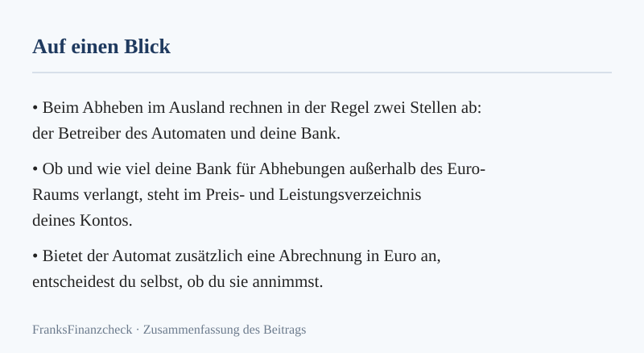
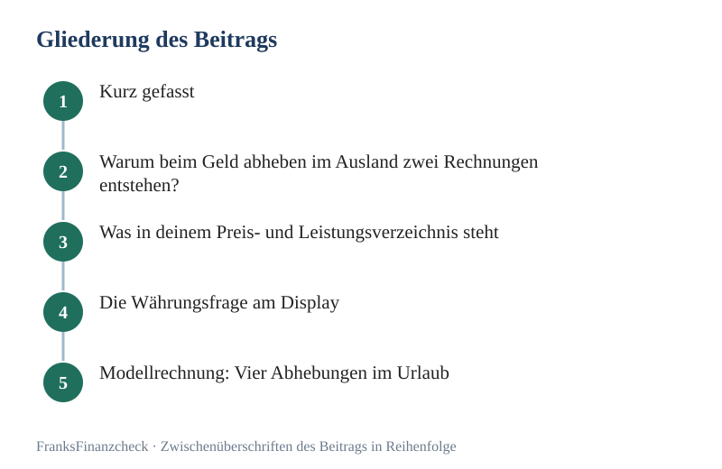

Beim Geld abheben im Ausland dauert der Vorgang am Strandautomaten in Portugal oder Kroatien keine Minute. Die Rechnung kommt später.

Sie passt oft nicht zum abgehobenen Betrag. Genau an dieser Stelle entsteht der Eindruck, die Bank habe sich vertan. Meistens hat sie nicht.

Beim Geldabheben im Ausland treffen zwei getrennte Abrechnungswelten aufeinander. Der Betreiber des Automaten verlangt sein eigenes Entgelt. Deine Bank berechnet, was sie für die Nutzung deiner Karte außerhalb des Euro-Raums vorsieht.

Wer diese zwei Posten auseinanderhält, kann schon vor der Reise entscheiden, mit welcher Karte er unterwegs ist. Geld abheben im Ausland ist eine Rechnung mit zwei Zeilen: der Automat und deine Bank. Wer beide kennt, gibt weniger Geld aus. Und er ärgert sich später seltener.

*Abbildung: Merkkarte zu „Geld abheben im Ausland: Wo die Gebühren wirklich entstehen“ (eigene Darstellung aus diesem Beitrag).*

## Kurz gefasst

* **Zwei Stellen rechnen ab:** Der Betreiber vor Ort und deine Bank zu Hause.
* **Die Währungsfrage ist eine Entscheidung:** Bietet der Automat eine Abrechnung in Euro an, darfst du sie ablehnen.
* **Deine Quelle ist das Preisverzeichnis:** Dort steht, welche Entgelte für dein Konto gelten.
* **Die Karte entscheidet mit:** Girocard, Debitkarte und Kreditkarte sind nicht gleich bepreist.

💡 **Schnell-Tipp von FranksFinanzcheck:** Wenn du vor der nächsten Reise ohnehin deine Fixkosten prüfst, gehört das Konto in dieselbe Liste. Hier kannst du ein dauerhaft gebührenfreies Modell ansehen: [**Kostenloses C24 Girokonto ansehen**](/go/girokonto/)
*(Dieser Artikel enthält Affiliate-Links (Werbung). Beim Abschluss über einen Link erhalten wir eine Provision – für dich entstehen keine Mehrkosten.)*

## Warum beim Geld abheben im Ausland zwei Rechnungen entstehen?

Der Automat gehört fast nie deiner Hausbank. Vor Ort stellen örtliche Banken, Wechselbüros oder private Netze das Gerät auf.

Sie bieten den Dienst vor Ort an. Dafür verlangen sie ein direktes Entgelt am Gerät. Dieser Posten steht nie in der Preisliste deiner eigenen Bank.

Der zweite Posten entsteht daheim. Manche Banken verlangen für jeden Abzug außerhalb der Euro-Zone eine feste Gebühr.

Andere nehmen einen festen Satz in Prozent vom Betrag. Wieder andere kosten dort null Euro, drehen aber an anderen Stellen am Preis. Jede Bank rechnet eben anders.

Wichtig ist die Folge am Gerät: Erst rechnet der Automat in der Fremdwährung ab. Dann tauscht deine Bank den Betrag in Euro um. Beide Schritte kosten unter Umständen Geld und stehen einzeln auf dem Beleg.

## Was in deinem Preis- und Leistungsverzeichnis steht

In der Preisliste deines Kontos stehen alle festen Kosten sauber aufgelistet. Für Geld im Ausland findest du meist zwei Zeilen. Eine gilt im Euro-Raum, eine außerhalb. Die BaFin erklärt den Aufbau dieser Liste und deine Rechte im [Ratgeber zum Girokonto](https://www.bafin.de/DE/Verbraucher/Bank/Girokonto/girokonto_node.html).

Zudem zeigt dir der [Kontenvergleich](https://kontenvergleich.bafin.de/) der BaFin viele Tarife im klaren Vergleich. Du merkst dort schnell: Die Unterschiede zwischen zwei Konten sind oft viel größer als zwischen zwei Reiseländern.

Fehlt dir dein Papierheft, öffne einfach die Preisliste im Online-Banking. Suche dort nach den Worten „Zahlungsverkehr“ und „Kartenzahlung“. Diese zwei Stellen legen fest, was du im Urlaub am Ende wirklich zahlst.

## Die Währungsfrage am Display

Viele Automaten bieten auf dem Schirm direkt Euro an. Fachleute nennen das dynamische Währungsumrechnung. Der Betreiber des Geräts rechnet dann selbst um und setzt seinen eigenen Kurs fest. Das ist kein Service für dich, sondern ein gutes Geschäft für den Aufsteller.

Wählst du Euro am Schirm, siehst du zwar gleich den Endbetrag. Das wirkt nett, kommt aber meist teuer. Der Kurs liegt in der Regel klar schlechter als der Kurs deiner Hausbank. Lehne Euro deshalb ab – dann bucht der Automat in Landeswährung und deine Bank rechnet fair um.

Manchmal lässt dir ein Gerät keine Wahl und zeigt nur Euro an. Prüfe dann kurz am Handy, wie der echte Tageskurs heute steht. Der kurze Blick dauert zehn Sekunden und bewahrt vor teuren Fallen.

## Modellrechnung: Vier Abhebungen im Urlaub

Die folgende Modellrechnung nutzt ausdrücklich Annahmen, keine Marktwerte. Ersetze sie durch deine eigenen Zahlen.

Annahmen: Du reist zehn Tage. Du hebst vier Mal Geld ab, je 100 € Gegenwert.

Der Betreiber verlangt in der Annahme je 4 €. Deine Bank berechnet in der Annahme ein Entgelt von 2 % auf jeden abgehobenen Betrag. Das Euro-Angebot des Automaten wird nicht genutzt.

Rechenweg für den Automaten: 4 Abhebungen mal 4 € ergeben 16 €. Rechenweg für die Bank: 4 Abhebungen mal 100 € ergeben 400 €.

Davon 2 % sind 8 €. Modellrechnung: Die Summe liegt bei 24 € auf 400 € abgehobenen Gegenwert. Das entspricht 6 %.

Nun die Gegenprobe. Angenommen, du hebst ein einziges Mal 400 € ab.

Rechenweg: 1 Abhebung mal 4 € ergibt 4 € Automatenentgelt. Dazu 2 % auf 400 €, also 8 €. Modellrechnung: Zusammen 12 €. Der Unterschied zwischen beiden Szenarien liegt allein in der Zahl der Abhebungen.

Diese Rechnung zeigt den eigentlichen Hebel. Nicht die Höhe des einzelnen Betrags entscheidet, sondern die Anzahl der Vorgänge. Wer statt vier Mal nur zwei Mal abhebt, halbiert den festen Anteil sofort.

## Die Karte entscheidet mit

Nicht jede Karte im Portemonnaie ist gleich bepreist. Die Girocard ist auf den deutschen und teils europäischen Zahlungsverkehr zugeschnitten. Ob sie an einem Automaten in einem Nicht-Euro-Land überhaupt funktioniert, hängt vom Verbund und vom Land ab.

Die Debitkarte ist international ausgelegt. Sie bucht direkt auf dein Konto und wird an den meisten Automaten im Ausland akzeptiert. Entscheidend ist auch hier der Tarif deiner Bank, nicht das Logo auf der Karte.

Die Kreditkarte ist im Ausland oft das zuverlässigste Werkzeug. Sie funktioniert an Hotelschaltern, im Mietwagenbüro und an Automaten, die Debitkarten ablehnen. Ob sie für Abhebungen kostenlos ist, steht im Preisverzeichnis. Die Verbraucherzentrale sammelt dazu im [Ratgeber Girokonto](https://www.verbraucherzentrale.de/wissen/geld-versicherungen/sparen-und-anlegen/girokonto-was-sie-darueber-wissen-sollten-4990) die wichtigsten Punkte, die vor dem Abschluss zu klären sind.

Eine Karte allein reicht in der Praxis selten. Nimm im Urlaub mindestens zwei Karten aus verschiedenen Zahlungsnetzen mit. Wenn eine nicht akzeptiert wird, hast du noch eine zweite Möglichkeit – und musst nicht am Schalter eines Wechselbüros zum ungünstigen Kurs tauschen.

Die drei Gebührenarten, die dir am Automaten begegnen, auf einen Blick:

| Gebührenart | Wer sie erhebt | Was du dagegen tun kannst |
|---|---|---|
| Automatengebühr | der Betreiber des Automaten | Automaten des eigenen Kartenanbieters nutzen |
| Fremdwährungsaufschlag | deine Bank oder dein Kartenanbieter | in Landeswährung abrechnen lassen |
| Abhebegebühr | dein Kartenanbieter | Tarif, Freibetrag und Konditionen prüfen |

## Fünf Regeln für den Automaten

1. **Lies den Hinweis am Automaten, bevor du tippst.** Dort steht, ob ein Entgelt anfällt und wie hoch es ist.
2. **Wähle die Abrechnung in Landeswährung, wenn du gefragt wirst.** Damit entscheidet der Kurs deiner Bank, nicht der des Betreibers.
3. **Heb in einem Zug den Bedarf mehrerer Tage ab.** Jeder Vorgang kostet erneut.
4. **Nutze Automaten von Banken, nicht von Aufstellern in Touristenzonen.** Das ist keine Garantie, aber ein guter Anfang.
5. **Prüfe den Beleg, bevor du ihn wegwirfst.** Betrag in Landeswährung, angezeigter Kurs und Entgelt stehen darauf.

*Abbildung: Gliederung zu „Geld abheben im Ausland: Wo die Gebühren wirklich entstehen“ – 5 Stationen von „Kurz gefasst“ bis „Modellrechnung: Vier Abhebungen im Urlaub“ (eigene Darstellung).*

## Wechselstube oder Automat?

Am Flughafen und in Touristenzonen stehen Wechselstuben mit großen Kursanzeigen. Der angezeigte Kurs wirkt oft besser als der Automat.

Entscheidend ist aber, was auf der Anzeige wirklich steht. Meist sind zwei Kurse zu sehen: der Ankauf und der Verkauf. Für dich gilt immer der ungünstigere von beiden.

Rechne deshalb vor dem Umtausch eine Probe. Nimm den Betrag, den du wechseln willst, und rechne ihn mit dem Kurs, der für dich gilt. Ziehe zusätzlich eine mögliche Bearbeitungsgebühr ab. Vergleiche das Ergebnis mit dem Gegenwert, den dir deine Banking-App für denselben Betrag anzeigt.

In vielen Ländern ist der Automat der günstigere Weg. Der Grund ist unspektakulär: Der Kurs kommt von deiner Bank und nicht von einem Aufsteller, der von der Marge lebt. Ausnahmen gibt es. Wer in großen Städten eine Bankfiliale mit eigenem Automaten findet, fährt in der Regel am besten.

## Der Wochenend-Effekt

Devisenkurse werden an Handelstagen gestellt. Am Wochenende ruht der Handel. Manche Institute verwenden deshalb für Buchungen am Samstag und Sonntag einen Kurs, der vom Freitag stammt. Andere rechnen mit einem Aufschlag.

Für dich heißt das: Der Tag der Abhebung kann den Kurs beeinflussen. Wenn du flexibel bist, hebe an einem Werktag ab. Das ist keine Garantie für einen besseren Kurs, aber es vermeidet den Sonderfall.

Dasselbe gilt für den Bearbeitungstag im Modellfall. Deine Bank bucht die Abhebung nicht immer am selben Tag. Zwischen Nutzung und Kontobuchung können ein bis drei Tage liegen, abhängig von Feiertagen und vom Land. Plane deshalb etwas Puffer ein, wenn du nach der Rückkehr eine Rechnung erwartest.

## Selbstcheck in fünf Minuten

Wenn du heute nur wenig Zeit hast, reichen [fünf Minuten](../../posts/2026-09-20-finanzieller-puffer-wie-viel-notgroschen-ist-genug/) für die wichtigsten Antworten. Halte dafür deine Preisliste und deine Karten bereit.

1. **Zeile eins suchen:** Welches Entgelt gilt für Abhebungen außerhalb des Euro-Raums?
2. **Zeile zwei suchen:** Gilt dasselbe für Kartenzahlungen im Handel?
3. **Tageslimit notieren:** Wie viel kannst du pro Kalendertag abheben?
4. **Zweite Karte prüfen:** Ist sie aktiv und ebenfalls für das Reiseland freigegeben?
5. **Sperrnummer speichern:** Schreibe sie dir an eine Stelle, die nicht vom Handy abhängt.

Wer diese fünf Punkte vor dem Abflug erledigt, erlebt die Abrechnung danach deutlich entspannter. Die meisten Überraschungen entstehen nicht durch ein besonders hohes Entgelt, sondern durch ein Entgelt, das niemand erwartet hatte.

## Wenn die Abrechnung nicht zur Erwartung passt

Manchmal erscheint auf dem Auszug mehr als erwartet. Dann hilft der ruhige Weg. Sammle zuerst die Belege: Automatenbeleg, Kontoauszug, Preisverzeichnis. Notiere das Datum der Abhebung und den Vorgang.

Frage dann bei deiner Bank nach einer Aufstellung des Betrags. Gute Institute nennen dir den verwendeten Kurs, den Bearbeitungstag und die Entgelte einzeln. Aus dieser Aufstellung siehst du sofort, welcher Anteil vom Automaten stammt und welcher von deiner Bank.

Prüfe außerdem, ob die Karte im Ausland für Abhebungen freigegeben war. Fehlt die Freigabe, kann der Vorgang trotzdem klappen, aber über einen anderen Weg abgerechnet werden. Beides steht in den Nachrichten zu deinem Konto.

## Checkliste vor der Abreise

* **Preisliste lesen.** Suche die Zeilen zu Karten und Abhebungen im Ausland.
* **Zwei Karten einpacken.** Möglichst aus unterschiedlichen Netzen.
* **Kartenlimit prüfen.** Ein Tageslimit kann im Urlaub zu eng sein.
* **Freigaben kontrollieren.** Manche Banken verlangen eine Angabe vor der Reise.
* **Sperrnummern speichern.** Notiere die Nummer zum Sperren deiner Karte, nicht auf dem Handy allein.
* **Belege sammeln.** Bewahre bis zur Schlussrechnung alle Automatenbelege auf.

**Faustregel:** Vergleiche vor einer Auslandsreise die Gebühren für Abhebung und Kartenzahlung deiner bestehenden Karten – der günstigste Reisekurs gewinnt nichts, wenn jede Abhebung fünf Euro kostet.

**Für deinen nächsten Check:** Fotografiere im Zweifel die Gebührenanzeige vor der Bestätigung. So kannst du den am Automaten angezeigten Betrag später vom Entgelt deiner eigenen Bank unterscheiden.

## Häufige Fragen

### Kostet jede Abhebung im Ausland Geld?

Nicht zwingend. Ob und wie viel deine Bank berechnet, steht im Preisverzeichnis. Der Betreiber des Automaten kann unabhängig davon ein Entgelt erheben.

### Was ist besser: in Euro oder in Landeswährung abrechnen?

In der Regel ist die Abrechnung in Landeswährung der günstigere Weg, weil deine Bank umrechnet. Das Euro-Angebot des Automaten nutzt einen eigenen Kurs. Es gibt Ausnahmen, deshalb lohnt der kurze Vergleich mit dem Kurs in deiner Banking-App.

### Wie viele Abhebungen pro Urlaub sind sinnvoll?

So wenige wie möglich und so viel pro Vorgang wie vertretbar. Feste Entgelte je Vorgang fallen nur einmal an, wenn du einen größeren Betrag abhebst.

### Kann ich Gebühren nachträglich reklamieren?

Du kannst eine Aufschlüsselung verlangen und einzelne Posten prüfen lassen. Ob ein Entgelt erstattet wird, hängt von den vereinbarten Bedingungen ab. Belege helfen in jedem Fall.

### Gilt das auch im Euro-Raum?

Innerhalb des Euro-Raums gibt es keine Fremdwährungsumrechnung, weil beide Seiten in Euro rechnen. Betreiber dürfen aber trotzdem ein eigenes Entgelt verlangen.

### Was passiert bei einer Sperre im Urlaub?

Melde den Verlust sofort über die Sperrnummer deiner Bank. Viele Institute bieten eine Ersatzkarte an eine Adresse im Reiseland an. Kläre vorher, ob dieser Service in deinem Tarif enthalten ist.

**Weiterlesen:** [Ratgeber Konto & Karten](../../pillar/konto-karten/) · [Bankgebühren senken](../../posts/2026-10-24-bankgebuehren-senken-7-schritte-zum-guenstigeren-konto/) · [Einlagensicherung](../../posts/2026-09-23-einlagensicherung-wie-viel-guthaben-geschuetzt-ist/) · [Geschenkkarte](../../posts/2026-11-13-geschenkkarte-was-du-beim-kauf-und-aufladen-wissen-musst/)
**Lesetipp:** [Kostenloses Girokonto: So findest du ein Konto ohne Gebühren](../../posts/2026-08-17-kostenloses-girokonto-so-findest-du-ein-konto-ohne-gebuehren/)

---

👉 **Jetzt Konditionen ansehen:** [**→ Kostenloses C24 Girokonto ansehen**](/go/girokonto/)

## Weiterrechnen und vertiefen

- **Rechner:** [24-Monats-Effektivpreis-Rechner: Was der Tarif wirklich kostet](../../werkzeuge/effektivpreis-rechner/)

*Dieser Artikel enthält Affiliate-Links (Werbung). Beim Abschluss über einen Link erhalten wir eine Provision – für dich entstehen keine Mehrkosten.*
