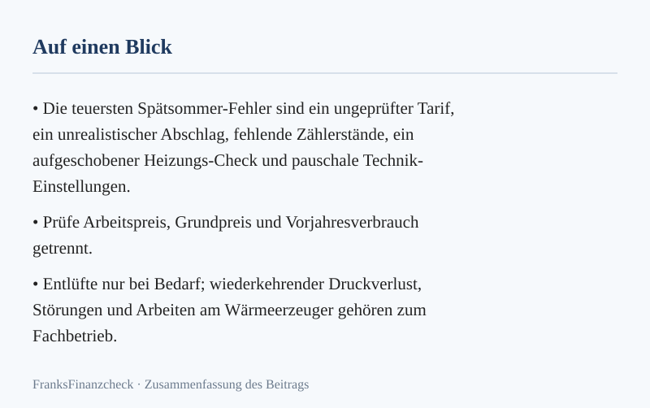
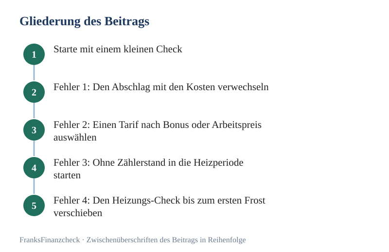

Wer seine [Gasrechnung senken](../../posts/2026-09-20-gasrechnung-senken-spaetsommer-check-spart-hunderte-euro/) will, sollte jetzt handeln. Die ersten kalten Nächte sind da. In diesen Wochen entscheidet sich, wie teuer dein Winter wird.

Ein früher Vergleich gibt dir Zeit, Angebote und Kündigungsfristen zu prüfen. Ob ein späteres Angebot günstiger ist, lässt sich nicht vorhersagen.

**Transparenz:** Dieser Artikel enthält Affiliate-Links (Werbung). Beim Abschluss über einen Link erhalten wir eine Provision – für dich entstehen keine Mehrkosten.

Das meiste Geld bleibt aus einem Grund liegen: Viele werfen **Preis, Verbrauch und Abschlag** in einen Topf. Wer die drei trennt, senkt seine Kosten spürbar.

---

💡 **Schnell-Tipp von FranksFinanzcheck:** Tarife kannst du über unseren Partner-Vergleich prüfen: [**Gas-Anbieter vergleichen & wechseln**](/go/gas/)
_(Dieser Artikel enthält Affiliate-Links (Werbung). Beim Abschluss über einen Link erhalten wir eine Provision – für dich entstehen keine Mehrkosten.)_

*Abbildung: Merkkarte zu „[Gasrechnung senken](../../posts/2026-09-20-gasrechnung-senken-spaetsommer-check-spart-hunderte-euro/): Fehler im Spätsommer vermeiden“ (eigene Darstellung aus diesem Beitrag).*

## Starte mit einem kleinen Check

Darum geht es hier konkret: Gasrechnung senken.

Prüfe deine Zahlen, bevor die Heizung richtig läuft. Vergleiche konkrete Angebote für deinen Wohnort und Verbrauch.

Nimm dir heute zehn ruhige Minuten. Hol die letzte Rechnung und notiere drei Werte: Verbrauch, Preis je kWh und Grundpreis im Jahr.

Mache dann ein Foto vom Gaszähler. Dieser Wert ist dein Startpunkt für jede spätere Rechnung. An der Technik musst du dafür nichts ändern.

Sieh dir danach deinen Vertrag an. Wann endet die Preisgarantie? Wie lang ist die [Kündigungsfrist](../../posts/2026-10-07-handyvertrag-kuendigen-raus-aus-der-kostenfalle-verlaengerung/)?

Vergleiche deinen Preis ohne Bonus mit dem Markt. Ein kleiner Abschlag spart kein Geld, er schiebt die Zahlung nur auf. Am Ende zählt die Summe für das ganze Jahr.

Zum Schluss folgt ein kurzer Rundgang. Steht ein Sofa vor dem Heizkörper? Hängt ein schwerer Vorhang davor?

Beides hält die Wärme fest und kostet dich Geld. Riechst du Gas oder zeigt das Gerät einen Fehler, rufe sofort einen Fachbetrieb.

## Das Wichtigste in Kürze

Ein Check vor dem Winter kann Sparmöglichkeiten zeigen. Bei angenommenen 18.000 kWh im Jahr ergibt ein Cent Unterschied je kWh rechnerisch 180 € im Jahr. Dein tatsächlicher Verbrauch steht auf der Rechnung.

- Ein niedriger Abschlag ist keine Ersparnis, sondern lediglich eine Vorauszahlung auf die Endabrechnung.
- Vergleiche Gastarife immer auf Basis deines realen Jahresverbrauchs und des effektiven Gesamtpreises.
- Dokumentiere Zählerstand und Zählernummer per Foto zum Start der Heizsaison (Stand: Oktober 2026).
- Prüfe Thermostate und Heizkörper frühzeitig auf Funktion, aber vermeide riskante Eingriffe in die Anlagensteuerung.
- Einsparungen durch verschiedene Maßnahmen lassen sich nicht einfach addieren, da sie oft denselben Basisverbrauch betreffen.
- Bei sicherheitsrelevanten Problemen wie Gasgeruch oder Druckverlust ist immer der Fachmann gefragt.

## Fehler 1: Den Abschlag mit den Kosten verwechseln

Dein Abschlag ist nur eine Vorauszahlung. Senkst du ihn, ohne weniger zu verbrauchen, sparst du nichts. Die Lücke holt sich der Anbieter mit der Jahresrechnung zurück.

Die voraussichtlichen Jahreskosten berechnest du nach dieser Formel:

> (Jahresverbrauch in kWh × Arbeitspreis) + jährlicher Grundpreis

Fiktive Beispielrechnung, keine Marktpreisangabe:

| Wert | Modellannahme |
|---|---:|
| Jahresverbrauch | 18.000 kWh |
| Arbeitspreis | ca. 11,50 ct/kWh |
| Grundpreis | ca. 195,00 € pro Jahr |
| **voraussichtliche Jahreskosten** | **ca. 2.265,00 €** |
| **rechnerischer Monatsabschlag** | **ca. 188,75 €** |

Steht dein Abschlag hier nur bei 150 €, fehlen am Ende über 460 €; das ist ein Beispielwert. Rechne einen Bonus erst mit, wenn du die Bedingungen sicher erfüllst.

### Besser so

Rechne nach jeder Preisänderung neu. Nach einem Umzug ebenso. Nimm dafür den Verbrauch aus dem Vorjahr, aber denke an das Wetter: Ein milder Winter schönt die Zahl.

## Fehler 2: Einen Tarif nach Bonus oder Arbeitspreis auswählen

Ein sehr kleiner Preis je kWh geht oft mit einem hohen Grundpreis einher. Auch ein dicker Bonus macht einen teuren Tarif im ersten Jahr schön.

Achte beim Vergleich mindestens auf:

- Den effektiven Jahresgesamtpreis bei deinem spezifischen Verbrauch,
- die Kostenstruktur im zweiten Vertragsjahr (nach Wegfall der Boni),
- die Laufzeiten und Kündigungsfristen,
- die Dauer der Preisgarantie und den Beginn des Schutzes,
- die angebotenen Zahlungsweisen.

Stelle das Portal zuerst auf „ohne Boni“. Dann siehst du den reinen Preis für die Energie. Prüfe die letzten Konditionen immer direkt beim Anbieter.

Vergleiche deinen Jahrespreis mit konkreten Angeboten für deinen Wohnort und Verbrauch. Ob ein Wechsel spart, zeigt erst die Rechnung inklusive Grundpreis und Bonusbedingungen.

## Fehler 3: Ohne Zählerstand in die Heizperiode starten

Ohne Startwert tappst du später im Dunkeln. War die Rechnung wegen eines Defekts hoch? Oder wegen des Preises? Oder war der Januar einfach kalt?

Erstelle zum Saisonstart ein Foto von:

- Dem aktuellen Zählerstand,
- der Zählernummer zur Identifikation,
- einem Zeitstempel (z. B. durch eine Tageszeitung im Bild oder digitale Metadaten).

Mache das jeden Monat. So hast du eine lückenlose Kette an Belegen. Schätzt dein Anbieter einmal zu hoch, kannst du das sofort widerlegen.

### Preis oder Verbrauch?

- **Verbrauch in kWh konstant, Kosten steigen:** Der Tarif oder die Preisbestandteile (Steuern, Umlagen) haben sich verteuert.
- **Verbrauch in kWh steigt deutlich:** Das Wetter war extremer, das Nutzerverhalten hat sich geändert oder die Anlagentechnik arbeitet ineffizient.
- **Abschlag sinkt, Jahreskosten bleiben hoch:** Hier droht eine Nachzahlung wegen zu gering kalkulierter Vorauszahlungen.

## Fehler 4: Den Heizungs-Check bis zum ersten Frost verschieben

Ein Probelauf im Oktober zeigt dir früh, ob alles läuft. Beim ersten Frost sind die Handwerker für Wochen ausgebucht.

Dein persönlicher Check-Up:

- Sind alle Heizflächen staubfrei und nicht zugestellt?
- Lassen sich die Thermostatventile leichtgängig drehen?
- Gibt es Gluckergeräusche oder bleiben Bereiche des Heizkörpers kalt?
- Sind an den Ventilen feuchte Stellen sichtbar?
- Passen die programmierten Heizzeiten noch zu deinem aktuellen Alltag?

Entlüfte nur bei Bedarf und genau nach Anleitung. Sieh danach auf den Druck der Anlage. Fällt er immer wieder ab, ist oft das Ausdehnungsgefäß defekt. Das ist ein Fall für den Profi.

## Fehler 5: Mit pauschalen Technikwerten experimentieren

Tipps wie „Stell den Druck auf 1,8 bar“ klingen gut, sind aber riskant. Das Gleiche gilt für „50 Grad Vorlauf reichen immer“. Jede Anlage ist anders.

Vorsicht gilt beim Nachfüllen von Wasser. Viele neue Geräte brauchen aufbereitetes Wasser nach VDI-Norm. Wasser aus der Leitung führt auf Dauer zu Kalk und Rost.

### Die sichere Reihenfolge

1. Aktuelle Einstellungen dokumentieren (Foto der Anzeige).
2. Die offizielle Bedienungsanleitung zurate ziehen.
3. Änderungen nur in kleinen Schritten vornehmen.
 Die Auswirkung über 2–3 Tage beobachten; das ist ein Modellwert.
5. Bei Unsicherheit die Einstellungen auf den Ursprungswert zurücksetzen.

## Was Verbrauchsmaßnahmen realistisch bringen?

Die [Verbraucherzentrale](https://www.verbraucherzentrale.de/wissen/energie/heizen-und-warmwasser/heizung-10-einfache-tipps-zum-heizkosten-sparen-13892) nennt rund 6 % weniger Heizenergie je Grad niedrigerer Raumtemperatur als Faustwert. Das Ergebnis hängt vom Gebäude und Heizverhalten ab; Räume dürfen nicht so weit auskühlen, dass Feuchte- oder Schimmelschäden entstehen.

Bei angenommenen 2.000 € verbrauchsabhängigen Heizkosten wären 6 % rechnerisch 120 €; feste Grundkosten bleiben unverändert. Das ist keine garantierte Ersparnis. Auch kurzes Lüften mit weit offenem Fenster hilft. Nachts die Rollläden zu schließen, bringt ebenfalls etwas.

Eines noch: Du darfst die Effekte nicht einfach addieren. Lies den Zähler jeden Monat ab. So siehst du schwarz auf weiß, was deine Schritte wirklich bringen.

*Abbildung: Gliederung zu „Gasrechnung senken: Fehler im Spätsommer vermeiden“ – 5 Stationen von „Starte mit einem kleinen Check“ bis „Fehler 4: Den [Heizungs-Check](../../posts/2026-09-11-guenstig-durch-den-winter-heizungs-check-im-spaetsommer/) bis zum ersten Frost verschieben“ (eigene Darstellung).*

## Dein Spätsommer-Check in 45 Minuten

| Zeit | Aufgabe |
|---:|---|
| 10 Minuten | Rechnungsdaten: Verbrauch, Arbeitspreis und Grundgebühr erfassen |
| 5 Minuten | Zählerstand und Nummer für die Dokumentation fotografieren |
| 10 Minuten | Sichtprüfung: Heizkörper, Ventile und Rohre auf Dichtheit prüfen |
| 10 Minuten | Umfeld-Check: Wärmestaus durch Möbel oder Vorhänge beseitigen |
| 10 Minuten | Tarif-Quick-Check: Aktuellen Preis gegen zwei Alternativen prüfen |

## Wann du sofort reagieren musst

Sicherheit geht vor Ersparnis. Riechst du Gas, zählt jede Sekunde. Dann ist keine Zeit für Checklisten.

Drücke keinen Schalter und zünde kein Feuer. Öffne die Fenster und drehe den Gashahn zu, wenn das ohne Gefahr geht. Verlasse das Haus und rufe von draußen den Notdienst oder die Feuerwehr.

Verliert die Anlage viel Wasser, muss ebenfalls ein Profi ran. Das gilt auch für Fehler, die immer wieder im Display stehen.

## Tarifwechsel ohne Versorgungslücke

Ein normaler Lieferantenwechsel ändert nichts am Netzanschluss. Verbrauchst du nach Vertragsende weiter Gas, ordnet der örtliche Grundversorger dich je nach Situation der Grund- oder Ersatzversorgung zu. Bei einer kurzen Wechselverzögerung ist es laut [Bundesnetzagentur](https://www.bundesnetzagentur.de/DE/Vportal/Energie/Vertragsarten/start.html) die Ersatzversorgung; nach regulärer Kündigung kann Grundversorgung entstehen. Die Konditionen können teurer sein.

Diese Daten solltest du bereithalten:

- Deinen geschätzten Jahresverbrauch,
- die Zählernummer (zu finden auf dem Gerät oder der letzten Rechnung),
- deine aktuelle Kundennummer beim jetzigen Versorger,
- das genaue Enddatum deiner aktuellen [Vertragslaufzeit](../../posts/2026-10-07-dsl-anbieter-wechseln-warum-treue-dich-bares-geld-kostet/).

Bei einer einseitigen Preisänderung können Verbraucher grundsätzlich zum Zeitpunkt der Änderung kündigen; Ausnahmen sind möglich. Prüfe dein Schreiben und die [Hinweise der Bundesnetzagentur](https://www.bundesnetzagentur.de/DE/Vportal/Energie/PreiseAbschlaege/start.html). Bei knapper Frist kündige selbst und nachweisbar.

> 💡 **Schnell-Tipp von FranksFinanzcheck:** Nutze für den Vergleich den echten Verbrauch aus deiner Rechnung: [**Gasanbieter vergleichen & wechseln**](/go/gas/). Der Link ist Werbung; für dich entstehen keine Mehrkosten.

## Wer kümmert sich um welchen Fehler?

Wer was darf, hängt von deiner Wohnform ab. Prüfe das, bevor du loslegst.

| Aufgabe | Mieter mit Zentralheizung | Mieter mit Gasetagenheizung | Eigentümer |
|---|---|---|---|
| Raumtemperatur/Lüften | Eigenverantwortung | Eigenverantwortung | Eigenverantwortung |
| Heizkörper frei halten | Eigenverantwortung | Eigenverantwortung | Eigenverantwortung |
| Technische Defekte | Meldung an Vermieter | Meldung an Vermieter | Beauftragung Fachbetrieb |
| [Gastarif wechseln](../../posts/2026-08-24-preisgarantie-gas-so-schuetzt-du-dich-vor-preisspruengen/) | Meist über Verwaltung | Bei eigenem Gaszähler möglich | Jederzeit möglich |
| Optimierung der Heizkurve | Nicht zulässig | Eingeschränkt möglich | Eigenverantwortung/Profi |
| Sanierung/Austausch | Vermietersache | Vermietersache | Eigenverantwortung |

Beschreibe ein Problem immer sachlich. Der Satz „Heizung kaputt“ hilft niemandem. Besser ist: „Heizkörper im Wohnzimmer bleibt unten kalt, trotz Stufe 5 und Entlüften.“

## Wenn du heute nur 15 Minuten hast

Auch ein kurzer Check kann dir zeigen, wo sich weiteres Prüfen lohnt. Achte dabei auf das Wichtigste:

1. **Rechnung scannen (5 Min):** Was bezahlst du pro kWh und wann kannst du kündigen?
2. **Zähler-Foto (3 Min):** Dokumentiere den Ist-Zustand für spätere Vergleiche.
3. **Funktionstest (4 Min):** Werden die wichtigsten Heizkörper warm, wenn du sie kurz aufdrehst?
4. **Termin setzen (3 Min):** Trage dir einen festen Termin für den Tarifvergleich in den Kalender ein.

Gehe [Schritt für Schritt](../../posts/2026-10-12-dein-weg-zu-geringeren-monatskosten-schritt-fuer-schritt/) vor. Wer am selben Tag den Anbieter wechselt, die Heizung herunterdreht und neue Thermostate einbaut, weiß am Ende nichts.

Welcher Schritt hat gewirkt? Das lässt sich dann nicht mehr sagen. Ein Schritt nach dem anderen bringt dir mehr.

Lies den Zähler nach zwei Wochen Heizbetrieb erneut ab; das ist ein Beispielwert. So siehst du Fehler früh. Und zwar bevor die teuren Monate Januar und Februar kommen.

Echtes Sparen braucht beides: einen guten Tarif und einen klugen Verbrauch. Wer nur auf den Preis schaut und dabei Wärme verschenkt, zahlt am Ende trotzdem zu viel.

Die [Verbraucherzentrale](https://www.verbraucherzentrale.de/wissen/energie/heizen-und-warmwasser/heizung-10-einfache-tipps-zum-heizkosten-sparen-13892) nennt für eine richtig eingestellte Heizungsanlage ein mögliches Einsparpotenzial von 10 bis 15 % Energie. Das betrifft die Anlageneinstellung, nicht pauschal deine gesamte Gasrechnung; Ausgangszustand und Gebäude entscheiden. Lass Einstellungen bei Unsicherheit von einem Fachbetrieb prüfen. Die Effekte verschiedener Maßnahmen sind nicht einfach Addierbar.

**Faustregel:** Prüfe vor dem Vergleich den Arbeitspreis pro Kilowattstunde und den Jahresverbrauch der letzten Abrechnung – der Bonus allein sagt nichts über die Ersparnis.

## Fazit: Fünf Fehler, eine klare Reihenfolge

Halte die Reihenfolge ein: erst die Daten, dann die Technik, zum Schluss der Markt. So fällst du nicht auf den kleinen Abschlag herein.

Dein nächster Schritt ist einfach. Hol heute deine letzte Rechnung heraus. Markiere den Preis je kWh und den Grundpreis.

Mit diesen zwei Zahlen siehst du in wenigen Minuten, ob dein Tarif noch mithalten kann.

**Weiterlesen:** [Heizungs-Check vor dem Winter](../../posts/2026-09-11-guenstig-durch-den-winter-heizungs-check-im-spaetsommer/) · [Gaspreisgarantie richtig prüfen](../../posts/2026-08-12-preisgarantie-gas-so-sicherst-du-dir-guenstige-tarife-fuer-2026/) · [Ratgeber Strom und Gas sparen](../../pillar/strom-sparen/)

## Häufige Fragen

### Senkt ein kleinerer Abschlag die Gasrechnung?
Nein. Ein kleiner Abschlag schont nur den Monat. Die Gesamtkosten ergeben sich aus Verbrauch und Tarif. Zu niedrige Abschläge enden in einer hohen Nachzahlung.

### Wann sollte ich den Gastarif vergleichen?
 Auch nach 12 Monaten ohne Blick auf den Markt lohnt es sich; das ist ein Modellwert. Der Oktober ist dafür ein guter Monat.

### Muss ich Heizkörper jedes Jahr entlüften?
Nein, das musst du nicht. Entlüfte nur, wenn es gluckert oder der Heizkörper ungleich warm wird. Zu häufiges Entlüften senkt den Druck ohne Grund.

### Wie viel spart ein Grad weniger?
Die Verbraucherzentrale nennt rund 6 % weniger Heizenergie pro Grad als Faustwert; das ist ein Rechenbeispiel. Das tatsächliche Ergebnis hängt von Haus, Heizverhalten und Preis ab.

### Darf ich den Gasanbieter auch im Winter wechseln?
Ja. Du darfst jederzeit wechseln, wenn du die Frist einhältst. Oder wenn du ein Sonderkündigungsrecht hast. Dein Gas fließt dabei ohne Lücke weiter.

---

👉 **Gastarif mit echten Zahlen prüfen:** [**→ Gasanbieter vergleichen**](/go/gas/)

## Weiterrechnen und vertiefen

- **Rechner:** [Strom- und Gas-Abschlagsrechner: Nachzahlung vorher erkennen](../../werkzeuge/abschlag-nachzahlung-rechner/)

*Dieser Artikel enthält Affiliate-Links (Werbung). Beim Abschluss über einen Link erhalten wir eine Provision – für dich entstehen keine Mehrkosten.*