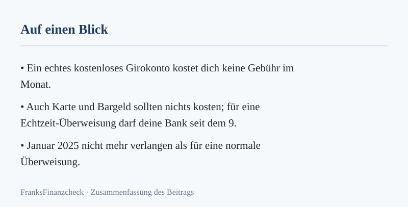
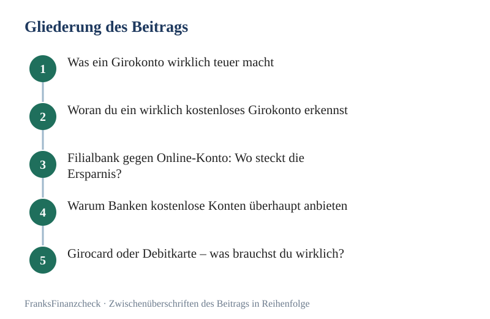

Du suchst ein kostenloses Girokonto? Dann bist du hier richtig. Millionen Menschen schenken ihrer Bank bis heute Geld.

Für ein einfaches Konto zahlen viele 8 € bis 18 € im Monat; das ist ein Modellwert. Das klingt nach wenig. Im Jahr sind es aber 96 € bis 216 €.

Auf zehn Jahre gerechnet sind das 960 € bis 2.160 € – eine Modellrechnung über denselben Zeitraum. Und das nur dafür, dass die Bank dein Geld verwaltet (Stand: November 2026).

Dabei ist der Markt heute besser denn je. Ein gutes Konto bringt dir eine starke App, Geld in Sekunden und oft sogar Zinsen. Eine Gebühr im Monat zahlst du dafür nicht.

Ein Punkt bleibt wichtig: Lies das Kleingedruckte. Viele Banken haben ihre Preise zuletzt geändert.

---

💡 **Schnell-Tipp von FranksFinanzcheck:** Ein dauerhaft günstiges Konto mit starker App und guten Alltagsfunktionen kannst du direkt prüfen: [**Kostenloses C24 Girokonto eröffnen**](/go/girokonto/)  
_(Dieser Artikel enthält Affiliate-Links (Werbung). Beim Abschluss über einen Link erhalten wir eine Provision – für dich entstehen keine Mehrkosten.)_

*Abbildung: Merkkarte zu „Kostenloses Girokonto: Ein Konto ohne Gebühren finden“ (eigene Darstellung aus diesem Beitrag).*

## Das Wichtigste in Kürze

- Ein echtes kostenloses Konto zeichnet sich durch 0 € Kontoführung aus, oft gekoppelt an einen Mindestgeldeingang als Modellwert.
- Wichtige Faktoren im Jahr 2026 sind die Bargeldversorgung, faire Dispozinsen und die Frage, ob eine Echtzeit-Überweisung dasselbe kostet wie eine normale – ein Aufpreis ist seit 2025 nicht mehr zulässig.
- Klassische Filialbanken berechnen für viele Kontomodelle laufende Gebühren. Wie hoch sie bei dir sind, steht im Preis- und Leistungsverzeichnis deiner Bank.
- Die Eröffnung ist in wenigen Minuten erledigt; den Umzug deiner Zahlungsaufträge regelt der gesetzliche Kontowechselservice über die Banken.
- „Kostenlos“ ist oft an Bedingungen geknüpft – achte besonders auf die Gebühren für physische Karten.

## Was ein Girokonto wirklich teuer macht

Die Gebühr im Monat ist nur die Spitze. Dahinter stecken viele kleine Posten. Sie machen ein Konto im Alltag teuer.

Typische Kostenfaktoren sind heutzutage:

- Monatliche Grundgebühren für die Kontoverwaltung,
- Jährliche Kosten für die Girocard (oft ca. 10 € bis 15 €); das ist ein Modellwert.
- Einzelgebühren für Leistungen wie SMS-TANs – für eine Echtzeit-Überweisung darf seit 2025 kein Aufpreis gegenüber einer normalen Überweisung verlangt werden,
- Hohe Gebühren für Abhebungen an Fremdautomaten,
- Hohe Dispozinsen, die bei Kontoüberzug sofort greifen,
- Gebührenaufschläge, falls ein monatlicher Mindesteingang unterschritten wird.

Glaube der Werbung nicht blind. Ein Konto kann ein halbes Jahr gratis sein. Danach ändert die Bank die Preise, und du zahlst doch.

## Woran du ein wirklich kostenloses Girokonto erkennst

Ein gutes Konto macht deinen Alltag leichter. Es verlangt keine Tabelle mit zwanzig Gebühren. Vier Punkte zeigen dir, ob ein Angebot fair ist.

### 1. Kontoführung dauerhaft bei 0 €

Manche Banken führen das Konto ohne jede Bedingung für 0 €; das ist ein Rechenbeispiel. Häufiger ist ein Modell mit Mindesteingang. Die Gebühr entfällt dann, wenn 700 € bis 1.000 € im Monat eingehen.

Für Angestellte ist das kein Problem. Wer studiert oder frei arbeitet, hat oft Monate mit weniger Geld. Für sie ist ein Konto ohne Bedingung die sichere Wahl.

### 2. Karte ohne Zusatzkosten

Im Jahr 2026 setzen die meisten Banken auf folgende Kombination:

- **Debitkarte (Visa oder Mastercard):** Diese ist in der Regel kostenlos enthalten und deckt Online-Shopping sowie weltweites Bezahlen ab.
- **Girocard (ehemals EC-Karte):** Viele Banken verlangen hierfür mittlerweile eine separate Jahresgebühr von ca. 10 € bis 20 €; das ist ein Modellwert.

Prüfe, ob du die Girocard brauchst. Im Supermarkt und in großen Läden reicht die Debitkarte. Nur in kleinen Betrieben und auf manchen Ämtern geht es ohne sie nicht.

### 3. Bargeld ohne Gebühr

Viele zahlen heute mit dem Handy. Bargeld bleibt trotzdem wichtig. Gute Anbieter lösen das so:

- Kostenlose Abhebungen an einer bestimmten Anzahl von Automaten pro Monat,
- Gebührenfreies Abheben im Einzelhandel (z. B. bei Supermärkten),
- Transparente Regeln für die Nutzung im Ausland.

Manche Banken nehmen 2 € bis 5 € pro Abhebung; das ist ein Rechenbeispiel. Damit ist deine Ersparnis schnell weg.

### 4. Dispozins nicht ignorieren

Das Konto ist gratis, der Dispo aber nicht. Der Dispozins steht im Preisverzeichnis und unterscheidet sich je nach Bank deutlich.

Einen Messwert liefert die Deutsche Bundesbank: Für revolvierende Kredite und Überziehungskredite an private Haushalte wies sie im September 2026 einen durchschnittlichen Effektivzins von 9,59 % pro Jahr aus; in den acht Monaten davor lag der Wert zwischen 9,19 % und 9,46 % (MFI-Zinsstatistik, Stand 02.11.2026); das ist ein Modellwert. Das ist ein Durchschnitt über alle Banken – dein eigener Satz kann deutlich darüber oder darunter liegen. Vergleiche deshalb den Zinssatz deines Kontomodells, bevor du den Dispo nutzt.

Vielleicht planst du gar kein Minus. Kommt es trotzdem, ist ein fairer Zins bares Geld wert.

## Filialbank gegen Online-Konto: Wo steckt die Ersparnis?

Eine Filiale kostet Miete und Personal. Diese Kosten trägst du über die Gebühr. Eine Online-Bank hat diese Last nicht und gibt den Vorteil an dich weiter.

### Beispielhafte Gegenüberstellung

| Kostenpunkt | Klassische Filialbank | Modernes Online-Konto | Unterschied |
|---|---:|---:|---:|
| Kontoführung (Modellannahme) | 10,00 € pro Monat | 0,00 € | 120,00 € im Jahr |
| Karte (Modellannahme) | 15,00 € pro Jahr | 0,00 € | 15,00 € |
| Echtzeit-Überweisung | kein Aufpreis zulässig | kein Aufpreis zulässig | Preisgleichheit seit 09.01.2025 |
| Bargeld | meist nur Eigenverbund | oft sehr flexibel | Zeit & Komfort |
| Dispozins | steht im Preisverzeichnis | steht im Preisverzeichnis | Marktdurchschnitt 9,59 % (Bundesbank, Sept. 2026) |
| **Jahr gesamt (Modell)** | **135,00 €** | **0,00 €** | **135,00 €** |

Das heißt nicht, dass Filialen schlecht sind. Für das reine Konto zahlst du dort aber oft einen Aufpreis. Die Tabelle ist eine Modellrechnung aus zwei Annahmen – 10,00 € Kontoführung im Monat und 15,00 € Karte im Jahr – und keine Marktmessung. Wie groß der Unterschied bei dir wirklich ist, zeigt erst der Blick in beide Preis- und Leistungsverzeichnisse.

## Warum Banken kostenlose Konten überhaupt anbieten

Keine Bank arbeitet ohne Gewinn. Auch am Gratis-Konto verdient sie. Nur eben auf anderen Wegen:

1. **Interchange-Gebühren:** Bei jeder Kartenzahlung zahlt der Händler eine kleine Gebühr, die teils an deine Bank fließt.
2. **Zinsdifferenzgeschäfte:** Die Bank arbeitet mit den Einlagen auf deinem Konto.
3. **Zusatzangebote:** Oft ist das Girokonto der Einstieg für lukrativere Produkte wie Depots, Versicherungen oder Kredite.
4. **Sollzinsen:** Wenn Kunden den Dispo nutzen, verdient die Bank an den Zinsen.

Für dich ist das gut. Du musst nur bei den Leistungen bleiben, die wirklich nichts kosten.

## Girocard oder Debitkarte – was brauchst du wirklich?

Der Unterschied der Karten zählt heute mehr als früher. Viele Banken geben die Girocard nur noch gegen Aufpreis aus.

### Debitkarte ist stark bei:

- Zahlungen im Internet und in Apps,
- Auslandsaufenthalten und Reisen,
- Echtzeit-Kontrolle via Push-Benachrichtigung,
- Kontaktlosem Bezahlen via Apple Pay oder Google Pay.

### Girocard ist noch nützlich bei:

- Kleinen Handwerksbetrieben oder ländlichen Bäckereien,
- Einigen lokalen Bürgerämtern,
- Parkautomaten älterer Bauart.

Nimmt dein Stammladen aber nur sie an, plane 1 € bis 2 € im Monat ein; das ist ein Rechenbeispiel.

## Kontowechsel: Viel einfacher als sein Ruf

Viele bleiben aus Angst vor dem Papierkram. Dabei läuft der Wechsel heute fast von allein.

Der typische Ablauf ist heute kinderleicht:

1. Online-Eröffnung des neuen Kontos in wenigen Minuten.
2. Identitätsprüfung bequem per App (Video-Ident oder eID).
3. Nutzung des gesetzlichen Kontowechselservices nach §§ 21 ff. ZKG: Deine neue Bank muss innerhalb von zwei Geschäftstagen nach deiner Ermächtigung die alte Bank beauftragen. Übermittelt werden unter anderem deine Daueraufträge, die Lastschriftmandate und die Buchungen der letzten 13 Monate.
4. Deine Lastschriftpartner erfahren die neue Kontoverbindung – bei vielen Banken automatisch, bei manchen musst du selbst Bescheid sagen.
5. Finale Kündigung des alten Kontos nach einer Übergangszeit.

### Mein Praxistipp zum Umzug

Lass dein altes Konto noch zwei bis drei Monate offen; das ist eine Modellannahme. So siehst du, ob auch der Beitrag für die Versicherung sauber umzieht. Erst danach kündigst du.

*Abbildung: Gliederung zu „Kostenloses Girokonto: Ein Konto ohne Gebühren finden“ – 5 Stationen von „Was ein Girokonto wirklich teuer macht“ bis „Girocard oder Debitkarte – was brauchst du wirklich?“ (eigene Darstellung).*

## Welche Extras ein gutes Konto 2026 haben darf

Ein gutes Konto ist mehr als ein Geldbeutel auf dem Handy. Diese Dinge gehören heute zum Standard.

Achte beim Vergleich auf:

- **Echtzeit-Überweisungen ohne Aufpreis:** Geld innerhalb von Sekunden senden. Mehr als eine normale Überweisung darf sie seit 2025 nicht kosten.
- **Intuitive Banking-App:** Mit Kategorisierung deiner Ausgaben.
- **Unterkonten (Pockets):** Zur Trennung von Erspartem, Miete oder dem [Notgroschen](../../posts/2026-09-09-notgroschen-die-wahrheit-ueber-das-finanzielle-polster/).
- **Sicherheitsfeatures:** Karten-Sperre und Limit-Anpassung direkt in der App.
- **Support:** Erreichbarkeit via Chat oder Hotline bei Problemen.

Vor allem Unterkonten helfen beim Sparen. Du siehst sofort, welches Geld für welches Ziel reserviert ist.

## Wann eine Filialbank ihren Preis wirklich wert sein kann

Eine Filiale hat trotzdem ihre Momente. Sie lohnt sich für dich, wenn du:

- Häufig größere Mengen Bargeld oder Münzgeld einzahlen musst,
- Wertgegenstände in einem physischen Schließfach lagern möchtest,
- Eine komplexe persönliche Beratung für Immobilienfinanzierungen vorziehst,
- Dich mit reinem App-Banking unsicher fühlst.

Für die meisten Kunden wiegt die Ersparnis beim Online-Konto aber schwerer.

## So prüfst du ein Girokonto in 10 Minuten

Ein kurzer Check spart dir bares Geld. Geh diese Liste durch:

1. Ist die Kontoführung bedingungslos oder an einen Geldeingang geknüpft?
2. Was kosten die physischen Karten (Debit und Girocard) pro Jahr?
3. Wie viele kostenlose Abhebungen sind inklusive?
4. Wie hoch ist der Dispozins (Sollzinssatz)?
5. Verlangt die Bank für Echtzeit-Überweisungen mehr als für normale Überweisungen? Zulässig ist das seit 2025 nicht.
6. Bietet die App moderne Funktionen wie Unterkonten oder Sparziele?

Passen die Antworten zu deinem Alltag, hast du dein Konto gefunden.

> 💶 **Spar-Tipp von FranksFinanzcheck:** Wer im Jahr 2026 noch unnötige Gebühren zahlt, verschenkt Kapital. Ein Wechsel streicht die früheren Kontogebühren – wie viel das bei dir ist, zeigt dein altes Preisverzeichnis. [**Jetzt C24 Girokonto prüfen**](/go/girokonto/)

## Was ein kostenloses Konto nicht leisten muss

Ein Gratis-Konto ist kein Paket für alles. Schutz auf Reisen oder ein Platz in der Lounge am Flughafen gehören nicht dazu. Dafür gibt es Konten gegen Gebühr.

Wichtig ist nur eines: Überweisen, Bezahlen und Abheben müssen ohne Zusatzkosten laufen. Alles Weitere bekommst du anderswo oft billiger.

**Faustregel:** Vergleiche vor der Kontoeröffnung die Jahreskosten inklusive Abhebe-, Karten- und Überweisungsgebühren – ein kostenloses Konto ist nicht günstig, wenn jede Leistung extra kostet.

## Fazit: Kostenlos ist gut – wenn das Konto auch im Alltag kostenlos bleibt

Ein **kostenloses Girokonto** bleibt die beste Wahl, wenn du auf den Preis achtest. Gute Alternativen zur teuren Filiale gibt es genug.

Du musst nur deinen Alltag kennen. Brauchst du oft Bargeld? Kommst du ohne Girocard aus?

Zahlst du heute mehr als 10 € im Monat, lohnt sich der Wechsel; das ist ein Rechenbeispiel. Er ist schnell erledigt und bringt dir jedes Jahr Geld für wichtigere Dinge.

**Weiterlesen:** [Ratgeber Konto & Karten](../../pillar/konto-karten/) · [Kreditkarte vergleichen](../../posts/2026-09-03-kreditkarte-vergleichen-kostenlos-sicher-bezahlen/) · [Ratgeber Versicherungen](../../pillar/versicherungen/)

## Häufige Fragen (FAQ)

### Ist ein kostenloses Girokonto wirklich dauerhaft kostenlos?
Viele Banken verlangen einen Mindesteingang, oft rund 700 € im Monat; das ist ein Modellwert. Andere sind ohne Bedingung gratis, nehmen aber Geld für die Karte.

### Brauche ich heute noch eine Girocard?
Meist reicht die Debitkarte. Kaufst du oft in kleinen Läden ein oder zahlst du auf dem Amt, prüfe die Girocard als Zusatz.

### Wie sicher ist mein Geld bei einer Online-Bank?
Hat die Bank eine deutsche Lizenz, sind Einlagen bis 100.000 € je Einleger und je Bank gesetzlich gesichert – einschließlich eventueller Zinsansprüche; das ist ein Beispielwert. Die Auszahlung muss spätestens sieben Arbeitstage nach Feststellung des Entschädigungsfalls erfolgen. Für besonders schutzwürdige Einlagen, etwa aus dem Verkauf einer Privatimmobilie, gilt bis zu sechs Monate lang ein erhöhter Schutz von 500.000 € ([Deutsche Bundesbank: Einlagensicherung](https://www.bundesbank.de/de/aufgaben/finanzaufsicht/einzelaspekte/einlagensicherung-597886)). Moderne Apps sind zudem sicher: Du bestätigst jede Zahlung doppelt und siehst jede Buchung sofort.

### Wirkt sich ein Kontowechsel negativ auf meinen Schufa-Score aus?
Ein Wechsel ab und zu ist normal und schadet dir nicht. Wer alle paar Monate wechselt, drückt seinen Wert aber kurz nach unten.

### Kann ich mit einem kostenlosen Konto überall Bargeld abheben?
Das hängt von der Karte und vom Netz ab. Viele Konten erlauben gratis Abheben an jedem Automaten mit Visa- oder Mastercard-Zeichen. Manche bieten Bargeld auch direkt im Laden.

### Was passiert mit meinen Lastschriften beim Wechsel?
Nach § 22 ZKG übermittelt deine alte Bank der neuen deine Daueraufträge, die verfügbaren Lastschriftmandate und die Buchungen der letzten 13 Monate. Ab dem von dir bestimmten Datum führt die alte Bank keine Daueraufträge mehr aus und nimmt keine Lastschriften mehr an. Sag deinem Arbeitgeber und deinem Vermieter trotzdem selbst Bescheid.

### Lohnt sich der Wechsel nur wegen 5 € im Monat?
Aus 5 € im Monat werden 60 € im Jahr; das ist ein Beispielwert. Der Wechsel kostet dich kaum Zeit und senkt deine festen Kosten dauerhaft.

### Was kostet ein Kontowechsel?
Der Wechsel selbst ist meistens gratis. Die neue Bank zieht viele Lastschriften selbst um. Prüfe nur die Schlussabrechnung deiner alten Bank.

### Funktioniert ein Gemeinschaftskonto ohne Aufpreis?
Bei vielen Anbietern ja. Beide Personen bekommen eine eigene Karte. Das Mindestgehalt zählt dann für beide zusammen.

---

👉 **Jetzt vergleichen und sparen:** [**→ Kostenloses Girokonto bei der C24 Bank eröffnen**](/go/girokonto/)

## Weiterrechnen und vertiefen

- **Rechner:** [Fixkosten-Scanner: Deine laufenden Kosten in einer Zahl](../../werkzeuge/fixkosten-scanner/)

*Dieser Artikel enthält Affiliate-Links (Werbung). Beim Abschluss über einen Link erhalten wir eine Provision – für dich entstehen keine Mehrkosten.*