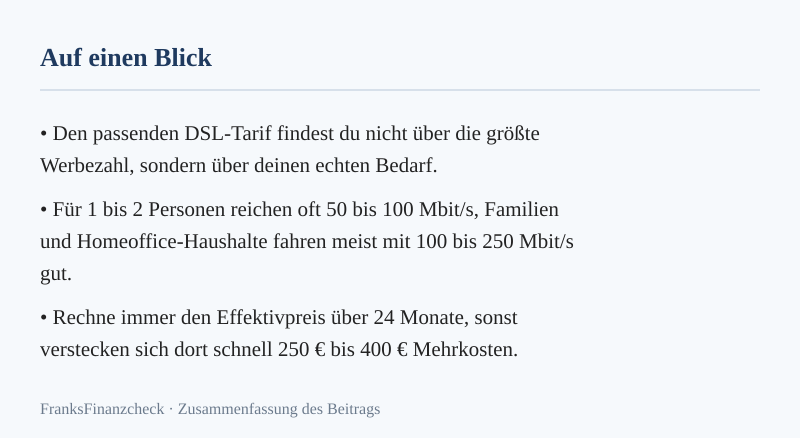
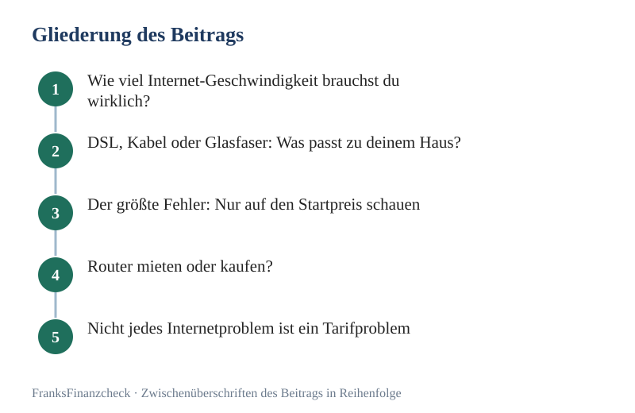

DSL-Tarif finden im Check: Viele Haushalte buchen 2026 überdimensionierte Pakete. Im Vertrag steht eine prestigeträchtige Zahl wie 1.000 Mbit/s. Im Alltag funktionieren aber nur ein paar smarte Geräte und zwei Laptops gleichzeitig. Das Ergebnis: Ein teurer Vertrag. Die Leistung im heimischen WLAN wird nie voll ausgeschöpft.

Dieser Ratgeber hilft dir, im Tarif-Dschungel den Durchblick zu behalten. Kein technisches Kauderwelsch. Nur das Wesentliche: Wie viel Geschwindigkeit brauchst du wirklich? Wann lohnt sich Glasfaser? Wie verhinderst du, dass versteckte Kosten deine Ersparnis auffressen?

**Das Wichtigste in Kürze**

- **50 bis 100 Mbit/s** sind für 1- bis 2-Personen-Haushalte die vernünftigste Wahl.
- **100 bis 250 Mbit/s** sind der Standard für Familien und intensives Homeoffice.
- **Gigabit-Tarife** sind ein Luxusgut. Sie lohnen sich für Haushalte mit extrem hohem Datenaufkommen.
- Achte beim Vergleich auf den **Effektivpreis über 24 Monate**. Nicht auf die niedrigen Einstiegspreise.
- Die Routermiete kostet oft **ca. 6 € bis 10 € pro Monat**. Über die Mindestlaufzeit summiert sich das auf **ca. 140 € bis 240 €**.
- Ein langsames Internet liegt oft nicht an der Leitung. Es liegt an veralteter WLAN-Hardware im Haus.

**Schnell-Tipp von FranksFinanzcheck:** Prüfe zuerst, welche Tarife an deiner Adresse verfügbar sind. Danach vergleichst du Preise, Boni und Routerkosten: [**DSL-Tarife vergleichen**](/go/dsl/) _(Dieser Artikel enthält Affiliate-Links (Werbung). Beim Abschluss über einen Link erhalten wir eine Provision – für dich entstehen keine Mehrkosten.)_

*Abbildung: Merkkarte zu „DSL-Tarif für dein Zuhause: Das passende Angebot finden“ (eigene Darstellung aus diesem Beitrag).*

## Wie viel Internet-Geschwindigkeit brauchst du wirklich?

Die entscheidende Frage heißt nicht: Was ist technisch möglich? Sie heißt: Was ruft dein Haushalt gleichzeitig ab? Die benötigte Bandbreite steigt zwar stetig. Aber oft langsamer als die Werbung glauben macht.

Für Singles, die gelegentlich streamen und im Homeoffice arbeiten, sind **50 Mbit/s** völlig ausreichend. Leben zwei Personen im Haushalt, die gleichzeitig in Videokonferenzen sitzen oder Serien schauen, bieten **100 Mbit/s** einen komfortablen Puffer. Erst wenn Kinder im Gaming-Alter dazukommen oder regelmäßig riesige Datenmengen bewegt werden, spielen Tarife mit **250 Mbit/s** ihre Stärken aus.

### Schnelle Orientierung nach Haushalt

| Haushalt | Typische Nutzung | Sinnvolle Bandbreite |
|---|---|---|
| 1 Person | Surfen, Streaming, gelegentlich Homeoffice | 50 Mbit/s |
| 2 Personen | paralleles Streaming, Video-Calls | 50 bis 100 Mbit/s |
| Familie | mehrere Geräte gleichzeitig, Homeoffice, Gaming | 100 bis 250 Mbit/s |
| WG / Power-User | viele Geräte, große Downloads, Cloud-Backups | 250 Mbit/s oder mehr |
| Spezialfälle | tägliche große Uploads, Medienarbeit | Glasfaser / Gigabit prüfen |

### Diese Anwendungen ziehen Bandbreite

- 4K-Stream (Ultra HD): ca. **15 bis 25 Mbit/s**
- Hochauflösende Video-Calls: ca. **5 bis 10 Mbit/s**
- Cloud-Synchronisation: oft **10 Mbit/s** oder deutlich mehr im Upload
- Gaming: Benötigt wenig Bandbreite, aber einen niedrigen Ping (Latenz)
- System-Updates: Können kurzzeitig die gesamte Leitung beanspruchen

Problematisch wird es, wenn die Nutzungsprofile kollidieren. Wenn ein Familienmitglied ein Spiel-Update lädt, während ein anderes an einer wichtigen Konferenz teilnimmt, ist eine stabile Leitung mit genügend Reserven Gold wert.

## DSL, Kabel oder Glasfaser: Was passt zu deinem Haus?

Die verfügbare Technik an deinem Wohnort bestimmt den Rahmen. Aber es gibt markante Unterschiede in der Performance und im Preisgefüge.

| Technik | Typischer Download | Typischer Upload | Stärke | Schwäche |
|---|---|---|---|---|
| DSL / VDSL | bis 250 Mbit/s | bis 40 Mbit/s | sehr stabil und fast überall verfügbar | Upload bauartbedingt limitiert |
| Kabel | bis 1.000 Mbit/s | ca. 25 bis 50 Mbit/s | viel Speed für vergleichsweise wenig Geld | "Shared Medium": Tempo kann abends sinken |
| Glasfaser | 300 bis 1.000+ Mbit/s | sehr hoch (symmetrisch möglich) | zukunftssicher, extrem stabil | noch nicht flächendeckend verfügbar |

### Wann DSL reicht

VDSL ist auch Ende 2026 das Rückgrat der deutschen Internetversorgung. Wenn an deinem Standort 100 Mbit/s stabil ankommen, ist das für die meisten Anwendungen mehr als genug. Es ist die vernünftige Lösung für alle, die keine Rekorde brechen, sondern einfach nur reibungslos arbeiten und entspannen wollen.

### Wann Kabel spannend ist

Kabel-Internet lockt oft mit hohen Downloadraten zu attraktiven Preisen. Besonders für Haushalte, die viel Content konsumieren, ist es eine Überlegung wert. Aber: Die Leistung kann in Ballungsgebieten zur Primetime (20:00 Uhr) nachgeben. Die Nachbarschaft teilt sich die Kapazität.

### Wann Glasfaser Sinn ergibt

Glasfaser (FTTH) ist die Premium-Variante. Sie bietet nicht nur enorme Download-Raten. Vor allem bietet sie einen überlegenen Upload. Wer beruflich mit Videoproduktion zu tun hat, ständig große Dateien in die Cloud schiebt oder ein [Smart Home](../../posts/2026-10-07-wie-smart-home-geraete-deine-stromrechnung-wirklich-druecken/) mit Dutzenden Geräten betreibt, sollte hier zugreifen. Sofern verfügbar.

## Der größte Fehler: Nur auf den Startpreis schauen

Ein Klassiker im Marketing: Ein extrem niedriger Preis in den ersten Monaten. Aktuell werben Anbieter oft mit Preisen von **ca. 10 € bis 20 €** im ersten Halbjahr. Danach steigt der Preis nach der Lockphase auf **ca. 45 € bis 55 €**.

Wer hier nicht nachrechnet, zahlt drauf. Entscheidend ist der **Effektivpreis über die gesamte Mindestlaufzeit von 24 Monaten**.

So berechnest du den echten Preis:

1. Summe aller Grundgebühren für 24 Monate.
2. Einmalige Bereitstellungs- oder Anschlussgebühren addieren.
3. Monatliche Routermiete über 24 Monate hinzufügen.
4. Alle Gutschriften, Cashbacks oder Boni abziehen.
5. Gesamtsumme durch 24 teilen.

### Rechenbeispiel (Stand: Oktober 2026)

| Posten | Tarif A (Lockvogel) | Tarif B (Konstant) |
|---|---|---|
| Erste 6 Monate (Aktion) | ca. 120 € | ca. 180 € |
| Restliche 18 Monate | ca. 900 € | ca. 720 € |
| Anschlussgebühr | ca. 40 € | 0 € |
| Routermiete (24 Mon.) | ca. 180 € | 0 € (eigenes Gerät) |
| Bonus / Cashback | -100 € | -50 € |
| **Gesamtkosten 24 Monate** | **ca. 1.140 €** | **ca. 850 €** |
| **Effektiv pro Monat** | **ca. 47,50 €** | **ca. 35,40 €** |

In diesem Beispiel wirkt Tarif A zunächst günstiger. Über zwei Jahre kostet er aber fast 300 € mehr als Tarif B.

## Router mieten oder kaufen?

Die Miete beim Provider ist bequem: Geht das Gerät kaputt, gibt es Ersatz. Aber die Anbieter lassen sich diesen Service gut bezahlen. Mit monatlichen Kosten von oft **ca. 7 € bis 10 €** ist ein hochwertiger Router nach spätestens zwei Jahren abbezahlt.

### Kauf lohnt sich oft, wenn …

- Du länger als zwei Jahre beim selben Standard bleibst.
- Du Wert auf spezifische Funktionen legst (VPN, Mesh-Optimierung).
- Du bei einem [Anbieterwechsel](../../posts/2026-10-07-dsl-anbieter-wechseln-warum-treue-dich-bares-geld-kostet/) nicht jedes Mal die Hardware zurückschicken willst.

### Miete kann okay sein, wenn …

- Du immer das neueste Top-Modell des Anbieters nutzen möchtest.
- Du technische Probleme komplett dem Support des Providers überlassen willst.
- Du nur für einen absehbaren Zeitraum an einem Ort wohnst.

Unterm Strich ist der Kauf eines eigenen Geräts (z. B. einer aktuellen FRITZ!Box) langfristig fast immer die günstigere Entscheidung.

## Nicht jedes Internetproblem ist ein Tarifproblem

Oft wird ein Upgrade gebucht, weil das Internet im Schlafzimmer ruckelt. Doch ein schnellerer Tarif bringt nichts, wenn das Signal auf dem Weg vom Router zum Endgerät verloren geht.

Prüfe vor einem Wechsel:

1. **LAN-Check:** Schließe einen Laptop direkt per Kabel an den Router an. Kommt die gebuchte Leistung dort an?
2. **WLAN-Abdeckung:** Nutze Apps, um die Signalstärke in verschiedenen Räumen zu messen.
3. **Hardware-Alter:** Ist dein Router vielleicht schon fünf oder sechs Jahre alt? Dann beherrscht er moderne Standards wie Wi-Fi 6 oder 7 eventuell gar nicht.

### Typische Deutung

| Beobachtung | Wahrscheinliche Ursache | Bessere Lösung |
|---|---|---|
| Speed per Kabel top, per WLAN Flop | Funkstörungen oder Distanz | Mesh-System oder Repeater einsetzen |
| Auch per Kabel zu langsam | Leitungsproblem | Störung beim Support melden |
| Nur zu Stoßzeiten langsam | Netzüberlastung | Anbieter- oder Technikwechsel (z. B. zu DSL/Glasfaser) |
| Verbindung stabil, aber teuer | Altvertrag ohne Rabatte | Tarifvergleich und Wechsel |

Falls dein WLAN das Nadelöhr ist, schau hier rein: [WLAN verbessern: So bringst du Speed in jede Ecke](../../posts/2026-08-14-wlan-verbessern-so-bringst-du-speed-in-jede-ecke/).

*Abbildung: Gliederung zu „DSL-Tarif für dein Zuhause: Das passende Angebot finden“ – 5 Stationen von „Wie viel Internet-Geschwindigkeit brauchst du wirklich?“ bis „Nicht jedes Internetproblem ist ein Tarifproblem“ (eigene Darstellung).*

## Vier Regeln vor der Unterschrift

### 1. Nur den Effektivpreis vergleichen

Lass dich nicht von "0 € in den ersten Monaten" blenden. Die Wahrheit steht in der Kalkulation über 24 Monate.

### 2. Den Wechsel vom neuen Anbieter steuern lassen

In der Regel übernimmt der neue Provider die Kündigung beim alten Anbieter. Er sorgt für einen nahtlosen Übergang. Das spart Nerven und verhindert Tage ohne Internet. Details dazu hier: [Praxis-Tipps beim DSL- und Internetwechsel](../../posts/2026-08-14-internet-dsl-wechseln-praxis-tipps-fuer-den-anbieterwechsel/).

### 3. Upload nicht ignorieren

Wer viel im Homeoffice arbeitet oder Backups nutzt, sollte auf mindestens **20 bis 40 Mbit/s Upload** achten. Ein riesiger Download bringt wenig, wenn die Gegenseite dich im Videocall nur verpixelt sieht.

### 4. Boni mitnehmen, aber Kleingedrucktes lesen

Cashback-Aktionen können die Kosten massiv drücken. Aber: Achte darauf, ob du eine Rechnung einreichen musst. Oder der Bonus automatisch nach einigen Monaten verrechnet wird. Mehr dazu im Guide zum [DSL-Wechselbonus](../../posts/2026-08-10-dsl-wechselbonus-sichern/).

## Welcher Tarif passt zu welchem Profil?

### Profil 1: Single oder Paar

In der Regel genügen hier **50 bis 100 Mbit/s**. Das reicht für zwei parallele HD-Streams und flüssiges Arbeiten vollkommen aus.

### Profil 2: Familie mit mehreren Geräten

Wenn Gaming, Netflix und Homeoffice gleichzeitig stattfinden, sind **100 bis 250 Mbit/s** die sicherste Wahl. Um Frust zu vermeiden.

### Profil 3: Power-User oder kreative Berufe

Wer professionell streamt oder große Datenmengen bewegt, sollte auf **Glasfaser oder High-Speed-Kabel mit mindestens 250–500 Mbit/s** setzen. Ideal mit hohem Upload-Anteil.

### Profil 4: Preisfokussierte Haushalte

Hier steht die Kostenoptimierung im Vordergrund. Oft ist ein dauerhaft günstiger 50-Mbit/s-Tarif ohne Schnickschnack die beste Wahl für das Budget.

## Mein 15-Minuten-Check vor jedem Tarifwechsel

Bevor du buchst, investiere diese Viertelstunde:

1. Aktuelle Kosten und [Kündigungsfrist](../../posts/2026-10-07-handyvertrag-kuendigen-raus-aus-der-kostenfalle-verlaengerung/) prüfen.
2. Tatsächlichen Bedarf ehrlich einschätzen. Reichen 100 Mbit/s vielleicht doch?
3. Verfügbarkeitscheck für DSL, Kabel und Glasfaser machen.
4. Router-Entscheidung treffen: Kauf-Hardware vorhanden?
5. Top 3 Angebote nach Effektivpreis (inkl. Router und Boni) vergleichen.
6. Bonusbedingungen kurz Querlesen.

> 💶 **Spar-Tipp zwischendurch:** Wer alle zwei Jahre konsequent wechselt, profitiert immer wieder von Neukunden-Vorteilen. Das spart im Schnitt **ca. 10 € bis 15 € pro Monat**. [**Jetzt DSL-Tarife vergleichen**](/go/dsl/)

**Faustregel:** Ein Tarif ist erst dann der richtige für dein Zuhause, wenn Bandbreite, Effektivpreis über 24 Monate und Routerkosten zu deinem Nutzungsverhalten passen.

## Fazit: Der beste DSL-Tarif ist nicht der schnellste, sondern der passendste

Im Oktober 2026 ist das Angebot an schnellen Leitungen so groß wie nie zuvor. Aber Geschwindigkeit ist nicht alles. Für die meisten Haushalte bleibt die Spanne zwischen **50 und 250 Mbit/s** der "Sweet Spot" aus Leistung und Preis.

Die wichtigste Lehre: Schau auf den **24-Monats-Preis**. Wer hier clever vergleicht, holt oft eine Ersparnis von **ca. 200 € bis 400 €** über die Laufzeit heraus. Ohne auf Komfort verzichten zu müssen.

**Weiterlesen:** [Pillar Internet & DSL](../../pillar/internet-dsl/) · [DSL-Wechselbonus sichern](../../posts/2026-08-10-dsl-wechselbonus-sichern/) · [Internet & DSL wechseln: Praxis-Tipps](../../posts/2026-08-14-internet-dsl-wechseln-praxis-tipps-fuer-den-anbieterwechsel/)

## Häufige Fragen

**Reichen 50 Mbit/s für Homeoffice und Streaming?**
Ja, für einen normalen Haushalt mit ein bis zwei Personen ist das meist völlig ausreichend. Solange nicht drei 4K-Streams gleichzeitig laufen, bietet diese Bandbreite eine solide Basis für flüssiges Arbeiten und Entertainment.

**Wann lohnt sich Glasfaser?**
Glasfaser ist immer dann die richtige Wahl, wenn du maximale Ausfallsicherheit und hohe Upload-Geschwindigkeiten suchst. Auch zur Wertsteigerung einer Immobilie oder für extrem datenintensive Anwendungen ist sie die Technik der Zukunft.

**Ist Kabel besser als DSL?**
Das kommt auf die Lage an. Kabel bietet oft mehr Download-Speed für das gleiche Geld. Aber in manchen Wohngebieten ist es anfälliger für Schwankungen zur Stoßzeit. DSL ist oft konsistenter in der Leistung. Aber bei der Höchstgeschwindigkeit limitiert.

**Soll ich den Router lieber kaufen oder mieten?**
Wirtschaftlich ist der Kauf eines eigenen Geräts meist nach etwa zwei Jahren im Vorteil. Die Miete bietet hingegen einen Rundum-Sorglos-Service inklusive Hardware-Support und schnellem Austausch bei Defekten.

**Wie erkenne ich, ob mein Problem am WLAN liegt?**
Führe einen Speedtest per LAN-Kabel direkt am Router durch. Ist dieser deutlich schneller als der Test über WLAN, liegt die Ursache an deiner Funkverbindung oder der Router-Position. Nicht an deinem Tarif.

**Wann sollte ich mit dem Wechsel anfangen?**
Idealerweise prüfst du deine Optionen etwa drei bis vier Monate vor Ablauf deiner [Vertragslaufzeit](../../posts/2026-10-07-dsl-anbieter-wechseln-warum-treue-dich-bares-geld-kostet/). So hast du genügend Zeit für den Vergleich. Und der neue Anbieter kann die Kündigungs- und Umschaltprozesse rechtzeitig einleiten.

---

👉 **Jetzt vergleichen und sparen:** [**→ Jetzt DSL-Tarife vergleichen**](/go/dsl/)

**Rechner:** [24-Monats-Effektivpreis-Rechner: Was der Tarif wirklich kostet](../../werkzeuge/effektivpreis-rechner/)

*Dieser Artikel enthält Affiliate-Links (Werbung). Beim Abschluss über einen Link erhalten wir eine Provision – für dich entstehen keine Mehrkosten.*
