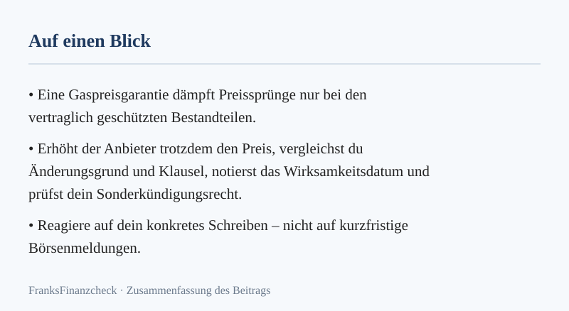
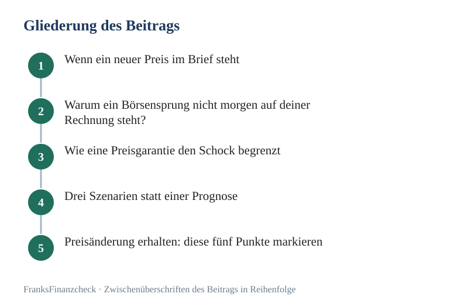

Eine [Preisgarantie beim Gas](../../posts/2026-08-12-preisgarantie-gas-so-sicherst-du-dir-guenstige-tarife-fuer-2026/) klingt beruhigend. Springt der Börsenpreis, warnt schnell eine Schlagzeile.

Sollst du jetzt sofort einen Vertrag für zwei Jahre unterschreiben? Bleib ruhig. Der Preis an der Börse wirkt nicht eins zu eins und nicht sofort auf deinen Tarif als Kunde.

**Transparenz:** Dieser Artikel enthält Affiliate-Links (Werbung). Beim Abschluss über einen Link erhalten wir eine Provision – für dich entstehen keine Mehrkosten.

Wichtig wird es erst, wenn dein Anbieter den Preis wirklich ändert oder deine Garantie endet. Dann zählen Klausel, Frist und deine Kosten im Jahr.

---

💡 **Schnell-Tipp von FranksFinanzcheck:** Tarife kannst du über unseren Partner-Vergleich prüfen: [**Gas-Anbieter vergleichen & wechseln**](/go/gas/)
_(Dieser Artikel enthält Affiliate-Links (Werbung). Beim Abschluss über einen Link erhalten wir eine Provision – für dich entstehen keine Mehrkosten.)_

*Abbildung: Merkkarte zu „[Preisgarantie Gas](../../posts/2026-08-12-preisgarantie-gas-so-sicherst-du-dir-guenstige-tarife-fuer-2026/): Was bei Preiserhöhung hilft“ (eigene Darstellung aus diesem Beitrag).*

*Abbildung: Merkkarte zu „Preisgarantie Gas: Was bei Preiserhöhung hilft“ (eigene Darstellung aus diesem Beitrag).*

## Wenn ein neuer Preis im Brief steht

Leg das Schreiben neben deinen Vertrag. Markiere den alten und den neuen Preis je kWh.

Markiere auch den Tag, an dem der neue Preis gelten soll. Suche danach die Stelle zum Preis-Schutz. So erkennst du, ob der Grund im Brief zu dem Schutz im Vertrag passt.

Rechne dann den Preis für ein Jahr mit deinem Verbrauch. Lass dabei den Bonus weg.

Vergleiche den Wert mit zwei neuen Angeboten. Ein Wechsel kann gut sein, muss aber nicht die beste Wahl sein. Dein alter Vertrag kann auch mit neuem Preis noch fair sein.

Mach ein Foto vom Zähler, bevor ein neuer Preis gilt. Speichere Brief, Vertrag und Foto an einem Ort. Das hilft, wenn du später nachfragen oder kündigen willst. Bei Streit holst du dir Rat, statt Zahlungen ohne Plan zu stoppen.

## Das Wichtigste in Kürze

- Börsenpreis und Haushaltsgaspreis sind nicht dasselbe.
- Eine Garantie schützt nur die ausdrücklich erfassten Preisbestandteile.
- Lies bei einer Erhöhung Änderungsgrund, neuen Preis und Wirksamkeitsdatum.
- Bei einer einseitigen Preisänderung kannst du grundsätzlich zum Zeitpunkt der Änderung Sonderkündigen; Ausnahmen sind möglich.
- Bestimmte hoheitliche Anpassungen oder Umsatzsteueränderungen können anders behandelt werden.
- Kündige bei knapper Sonderfrist selbst und nachweisbar.
- Schließe keinen teuren Tarif nur aus Angst vor einer Schlagzeile ab.

## Warum ein Börsensprung nicht morgen auf deiner Rechnung steht

Versorger kaufen Gas zu verschiedenen Zeiten und über getrennte Verträge ein. Dazu kommen Netz-Kosten, Vertrieb, Steuern, Abgaben und Umlagen. Dein Gaspreis ist also kein Live-Ticker vom Großhandel.

Auch ein fallender Börsenpreis kommt nicht immer sofort bei dir an. Genau deshalb vergleichst du deinen Tarif mit Angeboten von heute. Eine einzelne Tagesbewegung sagt nichts über das ganze Jahr.

Für deine Entscheidung vergleiche aktuelle Angebote für Wohnort und Verbrauch mit dem Gesamtpreis deines Vertrags.

## Wie eine Preisgarantie den Schock begrenzt

Eine Garantie begrenzt dein Risiko steigender Preise bei den vertraglich geschützten Bestandteilen. Ob ein vergleichbarer Tarif dafür mehr kostet, zeigt erst der konkrete Vergleich. Ein Aufpreis ist nicht zwingend.

Typische Ausnahmen betreffen:

- Steuern,
- Abgaben und Umlagen,
- Netzentgelte,
- gesetzlich veranlasste neue Preisteile.

Die Einkaufskosten sind laut Verbraucherzentrale meist geschützt. Ob auch Grundpreis und Netz-Kosten geschützt sind, musst du im Vertrag nachlesen.

## Drei Szenarien statt einer Prognose

Angenommen, dein Verbrauch liegt bei 20.000 kWh. Tarif A kostet 10,8 Cent pro kWh und hat eine enge Garantie. Tarif B kostet 11,3 Cent und schützt mehr Bestandteile. Beide haben vereinfacht 180 € Grundpreis.

| Szenario | Tarif A | Tarif B |
|---|---|---|
| keine Änderung | 2.340 € | 2.440 € |
| A steigt nach 6 Monaten für 60 % des Verbrauchs um 1,5 ct | 2.520 € | 2.440 € |
| A sinkt nicht, Marktangebote werden 1 ct günstiger | 2.340 € bis Wechsel | 2.440 € gebunden |

Die zweite Zeile rechnet mit 12.000 kWh × 1,5 Cent = 180 € Mehrkosten. Das ist ein Modellwert. Tarif B kostet anfangs 100 € mehr. In diesem Fall wäre er aber 80 € günstiger.

Das ist keine Vorhersage. Es zeigt nur den Preis für die Sicherheit. Eine Garantie kauft dir Planung – keine sichere Ersparnis.

## Preisänderung erhalten: diese fünf Punkte markieren

1. Bisherigen und neuen Arbeitspreis,
2. bisherigen und neuen Grundpreis,
3. Grund der Änderung,
4. Datum, ab dem sie gilt,
5. Hinweis auf das Sonderkündigungsrecht.

Vergleiche dann die Änderung mit deiner Garantie. Steigt ein geschützter Teil während der Garantiezeit, ist die Erhöhung vielleicht nicht erlaubt. Ist der Teil klar ausgenommen, kann es anders aussehen.

## Was die Bundesnetzagentur zu Preisänderungen sagt

Die [Bundesnetzagentur](https://www.bundesnetzagentur.de/DE/Vportal/Energie/PreiseAbschlaege/start.html) nennt klare Pflichten. Außerhalb der Grundversorgung muss der Anbieter Haushaltskunden mindestens einen Monat vorher informieren. Er muss Anlass, Voraussetzungen und Umfang der Änderung nennen. Auch dein Sonderkündigungsrecht muss im Schreiben stehen.

Für die Grundversorgung gelten strengere Regeln nach § 5 StromGVV/GasGVV. Prüfe zuerst deine Vertragsart.

Kündigst du zum Zeitpunkt der Änderung, endet dein Vertrag am Vortag – eine Frist musst du nicht abwarten. Ausnahmen gelten unter anderem bei einer vereinbarten separierten Preisanpassungsklausel für bestimmte hoheitliche Änderungen. Ausgenommen ist auch die reine Weitergabe einer Umsatzsteueränderung. Beides prüfst du am Schreiben und an deiner Klausel.

Darum lautet die sichere Regel: **Nicht nur die Überschrift lesen. Änderungsgrund und Vertragsklausel entscheiden.**

## Widersprechen oder wechseln?

### Wenn die Erhöhung der Garantie widerspricht

Schreib dem Anbieter, auf welche Klausel du dich beziehst. Widersprich nachweisbar. Zahle Rechnungen nicht einfach falsch oder gar nicht. Hol dir bei Streit Hilfe von der Verbraucherzentrale oder einem Anwalt.

### Wenn die Erhöhung zulässig erscheint

Rechne den neuen Jahrespreis aus und vergleiche ihn. Wenn ein Sonderkündigungsrecht besteht, kannst du es nutzen, musst es aber nicht. Trotz Erhöhung kann dein alter Vertrag günstiger sein als ein neues Angebot.

### Wenn die Frist knapp ist

Kündige selbst, schriftlich, und verlange eine Bestätigung. Beim normalen Wechsel kann der neue Anbieter die Kündigung für dich übernehmen. Bei einer Sonderkündigung wegen der Erhöhung rät die Bundesnetzagentur: Handle selbst.

*Abbildung: Gliederung zu „Preisgarantie Gas: Was bei Preiserhöhung hilft“ – 5 Stationen von „Wenn ein neuer Preis im Brief steht“ bis „Preisänderung erhalten: diese fünf Punkte markieren“ (eigene Darstellung).*

## Jahrespreis nach einer Erhöhung rechnen

Der Arbeitspreis steigt von 10,5 auf 12,0 Cent. Der Unterschied beträgt 1,5 Cent pro kWh im Rechenfall.

Bei 18.000 kWh wären das für ein volles Jahr **270 €**. Das ist ein Rechenbeispiel.

Gilt der neue Preis nur für einen Teil des Abrechnungsjahres, musst du den Verbrauch zeitanteilig aufteilen. Gasverbrauch fällt nicht gleichmäßig an. Der Winter wiegt stärker.

Notiere deshalb zum Datum der Änderung den Zählerstand und übermittle ihn nach Vorgabe. So wird die Abgrenzung nachvollziehbarer.

## Wechsel ohne Versorgungslücke

Beim Wechsel bleibt der technische Anschluss unverändert. Verzögert sich der Start, greift die Grund- oder Ersatzversorgung. Strom oder Gas werden nicht wegen eines normalen Lieferantenwechsels abgestellt.

Trotzdem sollte der neue Vertrag rechtzeitig stehen. Bis dahin kann es teurer werden.

Halte bereit:

- Jahresverbrauch,
- Zählernummer oder Marktlokations-ID,
- Kundennummer,
- Kündigungsnachweis,
- Zählerstand zum Wechseltermin.

## So wählst du den neuen Schutz

Prüfe beim neuen Tarif:

- Gesamtpreis ohne Bonus,
- genauer Garantieumfang,
- Garantiebeginn und -ende,
- Laufzeit,
- [Kündigungsfrist](../../posts/2026-10-07-handyvertrag-kuendigen-raus-aus-der-kostenfalle-verlaengerung/),
- Zahlungsweise,
- Preis im Folgejahr.

Eine längere Garantie ist nicht automatisch sicherer. Wenn du dafür schon am Start 2 Cent pro kWh mehr zahlst, kostet die Absicherung bei 20.000 kWh 400 € jährlich.

## Verbrauch ist dein zweites Sicherheitsnetz

Garantierte Preise schützen nicht vor einem kalten Winter oder höherer Raumtemperatur. Senkst du den Verbrauch, sinkt auch dein Risiko bei jeder künftigen Änderung.

Prüfe deshalb Raumtemperaturen, Lüftung, freie Heizkörper und Anlagenzustand. Beachte dabei die Schimmelgrenze. Die Verbraucherzentrale empfiehlt, nicht unter 16 °C zu heizen.

Die [Verbraucherzentrale](https://www.verbraucherzentrale.de/wissen/energie/heizen-und-warmwasser/heizung-10-einfache-tipps-zum-heizkosten-sparen-13892) nennt etwa 6 % weniger Heizenergie pro Grad niedrigere Raumtemperatur als Faustwert. Wie viel du sparst, hängt von Gebäude und Ausgangswert ab.

> 💡 **Schnell-Tipp von FranksFinanzcheck:** Rechne den neuen Jahrespreis mit deinem echten Verbrauch und vergleiche erst dann: [**Gastarife prüfen**](/go/gas/). Der Link ist Werbung; für dich entstehen keine Mehrkosten.

## Eine einfache Entscheidungsampel

**Grün: bleiben**
Preis bleibt konkurrenzfähig, Garantie greift, Vertrag ist verständlich.

**Gelb: nachrechnen**
Erhöhung betrifft einen ausgenommenen Teil oder die Garantie läuft bald aus. Marktvergleich und Frist notieren.

**Rot: handeln**
Erhöhung widerspricht der Garantie, Schreiben ist intransparent oder neuer Jahrespreis liegt klar über vergleichbaren Angeboten. Widerspruch, Beratung oder Kündigung prüfen.

## Wenn die Garantie ausläuft, ohne dass der Preis steigt

Auch Schweigen ist ein Anlass zum Prüfen. Läuft die Garantie aus, kann der Vertrag zunächst zum bisherigen Preis weitergehen. Dein Schutz gegen spätere Änderungen ist dann aber weg.

Rechne vier bis acht Wochen vorher den aktuellen Jahrespreis und vergleiche ihn mit neuen Angeboten. Kündige nicht vorschnell, wenn dein Vertrag weiter günstig ist. Notiere stattdessen, wie flexibel du nach der Laufzeit wechseln kannst.

Es gibt drei mögliche Entscheidungen:

- **Bleiben:** Preis ist fair, Vertrag monatlich oder kurzfristig kündbar.
- **Tarif beim selben Anbieter wechseln:** neue Bedingungen und Laufzeit wie einen Neuvertrag prüfen.
- **Anbieter wechseln:** wenn Gesamtpreis oder Schutz klar besser sind.

Rückholangebote sind nicht von selbst günstig. Rechne Arbeitspreis, Grundpreis und Bonus erneut. Achte darauf, ob mit dem [Tarifwechsel](../../posts/2026-10-07-handyvertrag-kuendigen-raus-aus-der-kostenfalle-verlaengerung/) eine neue Laufzeit beginnt.

Sende eine Kündigung erst, wenn du die Folgen kennst. Endet der Vertrag ohne neuen Lieferanten, fällst du in Grund- oder Ersatzversorgung. Die Versorgung bleibt zwar gesichert, der Preis kann aber höher sein.

Bewahre ein abgelehntes Angebot nicht als ewigen Vergleich auf. Notiere das Datum. Ein Marktpreis von heute ist in einigen Wochen nur noch ein historischer Wert.

Setze nach jeder Entscheidung einen neuen Termin. Garantie, Laufzeit und Bonus haben oft unterschiedliche Enddaten. Drei Erinnerungen sind hier sinnvoller als die Hoffnung, dass der Anbieter rechtzeitig an deinen Geldbeutel denkt.

## Deine Unterlagen für Widerspruch oder Wechsel

Lege einen kleinen digitalen Ordner an. Er sollte Vertrag, AGB, Garantie, Änderungsschreiben, letzte Rechnung und Zählerfoto enthalten. Speichere außerdem versandte Kündigungen oder Widersprüche mit Datum und Nachweis.

Diese Ordnung hilft aus zwei Gründen. Erstens erkennst du, welche AGB-Fassung tatsächlich zu deinem Abschluss gehört. Zweitens kannst du den Verbrauch zum Preiswechsel sauber abgrenzen.

### Kurzer Text für die eigene Prüfung

Notiere in vier Zeilen:

- „Garantie gilt bis: …"
- „geschützt sind: …"
- „Anbieter erhöht wegen: …"
- „neuer Preis gilt ab: …"

Passen Schutz und Grund nicht zusammen, hol dir fachliche Hilfe. Passen sie zusammen, rechnest du Marktangebote gegen den neuen Jahrespreis.

Setze eine realistische Antwortfrist und bleib sachlich. Ein Widerspruch ersetzt keine Kündigung. Eine Kündigung löst nicht den Streit über bereits berechnete Preise.

Behandle beides getrennt. So verlierst du weder die Wechselfrist noch den Überblick über deine Forderung.

Prüfe nach dem Wechsel auch die Schlussrechnung. Ein sauberer neuer Vertrag heilt keinen falschen Endstand beim alten Anbieter.

## Fazit: Auf Schreiben reagieren, nicht auf Schlagzeilen

Preissprünge am Markt verdienen Aufmerksamkeit, aber keine Panik. Entscheidend ist dein Vertrag. Prüfe Garantie, neue Preise und Frist; rechne danach den Jahresbetrag.

Wenn heute ein Preisschreiben im Postfach liegt, fotografiere zuerst den Zählerstand. Markiere dann die fünf Pflichtpunkte. So wird aus Marktangst eine konkrete Entscheidung.

**Weiterlesen:** [Preisgarantie verständlich erklärt](../../posts/2026-08-10-sicher-heizen-so-schuetzt-dich-eine-preisgarantie-gas/) · [Gastarif Schritt für Schritt vergleichen](../../posts/2026-08-12-preisgarantie-gas-so-sicherst-du-dir-guenstige-tarife-fuer-2026/) · [Ratgeber Strom und Gas sparen](../../pillar/strom-sparen/) · [Balkonkraftwerk Förderung](../../posts/2026-10-09-balkonkraftwerk-foerderung-so-holst-du-dir-geld-zurueck/) · [Grundversorgung Strom und Gas](../../posts/2026-09-21-grundversorgung-strom-und-gas-was-sie-leistet/) · [Energieausweis](../../posts/2026-10-12-energieausweis-was-das-dokument-fuer-deine-fixkosten/)

## Häufige Fragen

**Gilt das Sonderkündigungsrecht bei jeder Preiserhöhung?**
Grundsätzlich ja: Kündige zum Zeitpunkt der Änderung. Der Vertrag endet am Vortag. Ausnahmen gelten etwa bei einer vereinbarten separierten Klausel für bestimmte hoheitliche Anpassungen. Auch die reine Steuerweitergabe kann ausgenommen sein. Prüfe das konkrete Schreiben.

**Wie schnell muss der Anbieter informieren?**
Haushaltskunden müssen grundsätzlich mindestens einen Monat vor der Änderung informiert werden. In der Grundversorgung gelten zusätzliche Pflichten. Bei reiner Steuerweitergabe gibt es Ausnahmen.

**Bleibt mein Abschlag trotz Garantie gleich?**
Nicht zwingend. Verbrauchsprognose oder ausgenommene Preisbestandteile können den Abschlag verändern. Verlange eine nachvollziehbare Berechnung.

**Sollte ich wegen steigender Börsenpreise sofort 24 Monate abschließen?**
Nein. Vergleiche zuerst aktuellen Gesamtpreis, Garantieumfang und Aufpreis für die längere Bindung.

**Was mache ich bei einer unklaren oder möglicherweise unzulässigen Erhöhung?**
Widersprich nachweisbar, prüfe dein Sonderkündigungsrecht und hol Hilfe bei der Verbraucherzentrale oder Schlichtungsstelle Energie.

---

👉 **Neuen Jahrespreis vergleichen:** [**→ Gastarife prüfen**](/go/gas/)

**Rechner:** [Strom- und Gas-Abschlagsrechner: Nachzahlung vorher erkennen](../../werkzeuge/abschlag-nachzahlung-rechner/)

*Dieser Artikel enthält Affiliate-Links (Werbung). Beim Abschluss über einen Link erhalten wir eine Provision – für dich entstehen keine Mehrkosten.*
