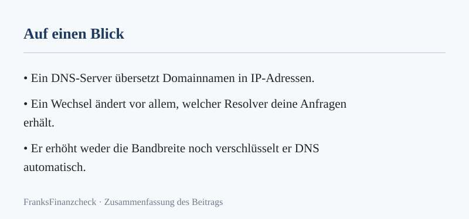
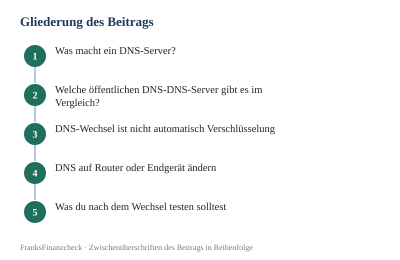

Wenn du den DNS-Server wechselst, änderst du den Server, der deine Namensanfragen bearbeitet. Das kann Filter, Datenschutz und die Antwortzeit beeinflussen. Es macht den Anschluss aber nicht schneller. Und es verschlüsselt DNS nicht automatisch.

**Transparenz:** Dieser Artikel enthält Affiliate-Links (Werbung). Beim Abschluss über einen Link erhalten wir eine Provision – für dich entstehen keine Mehrkosten.

**Das Wichtigste in Kürze**

- DNS-Server übersetzen Domainnamen in IP-Adressen. Sie beeinflussen nicht die [Bandbreite](../../posts/2026-11-12-wie-viel-streaming-bandbreite-du-wirklich-brauchst-dein/) des Anschlusses.
- Öffentliche DNS-Server können Anfragen verschlüsseln (DoH/DoT). Sie schützen aber nicht vor allen Netzwerkdaten.
- Filterfunktionen der Anbieter unterscheiden sich. Sie blockieren bekannte schädliche Domains. Sie ersetzen keinen Virenschutz.

*Abbildung: Merkkarte zu „DNS-Server wechseln: Datenschutz, Filter und Einrichtung“ (eigene Darstellung aus diesem Beitrag).*

## Was macht ein DNS-Server?

DNS steht für Domain Name System. Ein DNS-Server übersetzt Domainnamen wie `example.de` in IP-Adressen. Dein Gerät braucht die Adresse für den Verbindungsaufbau.

Betriebssystem, Router und DNS-Server können Antworten zwischenspeichern. Deshalb wird nicht bei jedem Seitenaufruf eine neue Anfrage gesendet.

Die DNS-Auflösung ist nur ein Schritt. Ein anderer Server verändert zwar diesen Schritt, aber er erhöht nicht die gebuchte [Bandbreite](../../posts/2026-11-12-wie-viel-streaming-bandbreite-du-wirklich-brauchst-dein/).

Er repariert auch kein schwaches WLAN. Das Ergebnis hängt von Leitung, Dienst, Route und dem Speicher im Gerät ab.

## Welche öffentlichen DNS-Server gibt es?

Die folgenden IPv4-Adressen stammen direkt von den Anbietern. Nutze beim zweiten Feld denselben Anbieter. So bleiben Filter und Datenschutz stets einheitlich.

| DNS-Server | Standard-IPv4 | Schwerpunkt laut Anbieter |
|---|---|---|
| Cloudflare 1.1.1.1 | `1.1.1.1`, `1.0.0.1` | Standard ohne Inhaltsfilter. Optionale Familienvarianten filtern Malware- und Phishing-Domains |
| Google Public DNS | `8.8.8.8`, `8.8.4.4` | Öffentlicher DNS-Server. Datenschutzseite beschreibt die Protokollierung |
| Quad9 Secure | `9.9.9.9`, `149.112.112.112` | Blockiert DNS-Anfragen an bekannte schädliche Domains |

### Cloudflare 1.1.1.1

Für IPv6 nennt Cloudflare `2606:4700:4700:1111` und `2606:4700:4700:1001`; das ist ein Modellwert. Die Paare `1.1.1.2` und `1.0.0.2` blocken bekannte Fallen. `1.1.1.3` und `1.0.0.3` filtern zudem Inhalte für Erwachsene.

Nutzt dein Gerät IPv6, trage auch dort dieselbe Filter-Adresse ein. Sonst laufen Abfragen teils ohne Schutz. Solche Filter ersetzen aber keine Sicherheitssoftware. Mitunter sperren sie auch harmlose Seiten ([Adressen und Filtervarianten](https://developers.cloudflare.com/1.1.1.1/ip-addresses/)).

Cloudflare schützt Anfragen per DoH oder DoT. Laut eigenem Hinweis löscht der Dienst Protokolle nach kurzer Zeit. Anonyme Statistiken bleiben aber teils länger stehen. Prüfe die [Details zur Protokollierung](https://developers.cloudflare.com/1.1.1.1/privacy/public-dns-resolver/) vor deiner Wahl.

### Google Public DNS

Die IPv6-Adressen lauten `2001:4860:4860:8888` und `2001:4860:4860:8844`; das ist ein Beispielwert. Googles [Einrichtungsanleitung](https://developers.google.com/speed/public-dns/docs/using) zeigt alle Schritte für Router und Endgeräte.

Google beschreibt in seinen Regeln kurze Logs mit IP und Anfrage, die rasch gelöscht werden. Bei Angriffen speichert der Dienst sie teils länger.

Dauerhafte Stichproben ohne IP enthalten nur Domains und grobe Orte. Laut Google fließen die Daten nicht in Werbung. Lies bei Bedarf die [aktuelle Datenschutzbeschreibung](https://developers.google.com/speed/public-dns/privacy).

### Quad9

Die IPv6-Adressen von Quad9 lauten `2620:fe:fe` und `2620:fe:9`; das ist ein Modellwert. Quad9 blockt Anfragen an bekannte Schad-Domains. Der Anbieter sammelt laut eigener Aussage keine persönlichen Daten.

Mehr zu allen [Dienstvarianten](https://docs.quad9.net/services/) und den [Datenschutzhinweisen](https://quad9.net/service/privacy/) steht direkt bei Quad9. Auch hier gilt: Ein Filter ersetzt keine System-Updates und keinen Schutz vor Viren.

## DNS-Wechsel ist nicht automatisch Verschlüsselung

Ein Wechsel ändert zuerst, wer deine Abfrage bearbeitet. Im alten Standard läuft die Abfrage oft offen durch das Netz. Ein Tausch der IP verhindert nicht, dass dein lokales Netz oder dein [Internetanbieter](../../posts/2026-10-07-dsl-anbieter-wechseln-warum-treue-dich-bares-geld-kostet/) die Ziele sieht.

DoH und DoT sichern den Weg zwischen Gerät und Server. So liest unterwegs niemand leicht mit. Der Betreiber des Servers sieht die Anfrage aber weiter.

Andere Daten im Netz bleiben dennoch sichtbar. Dazu zählen Ziel-IP, Uhrzeit und Datenmenge. HTTPS schützt zwar den Inhalt einer Seite. Vollständig unsichtbar macht es dich aber nicht.

Auch der private Modus im Browser hilft hier wenig. Er löscht nur Spuren auf deinem eigenen Gerät. Google verweist darauf, dass Arbeitgeber oder [Internetanbieter](../../posts/2026-10-07-dsl-anbieter-wechseln-warum-treue-dich-bares-geld-kostet/) den Traffic weiter sehen ([Chrome-Hilfe](https://support.google.com/chrome/answer/95464?hl=de)).

## DNS auf Router oder Endgerät ändern

Sichere vor jeder Änderung deine alten Werte mit einem Bild. So springst du bei Fehlern schnell zurück. Auf Geräten vom Arbeitgeber fragst du vorher die IT.

### FRITZ!Box als Beispiel

Bei vielen FRITZ!Box-Modellen liegen die Felder unter **Internet → Zugangsdaten** oder **Zugangsart → DNS-Server**. Der genaue Name hängt von Modell und FRITZ!OS ab. Aktiviere dort eigene Server für IPv4 und IPv6 und trage die Nummern ein. Die [FRITZ! Knowledge Base](https://fritz.com/en-at/apps/knowledge-base/fritz-box-6591-cable/165_Configuring-different-DNS-servers-in-the-FRITZ-Box) erklärt den Weg für ein festes Modell.

Für den Schutz per TLS braucht die Box mehr als eine Nummer. Bei DNS over TLS fragt die FRITZ!Box zusätzlich nach dem Servernamen. Nutze das nur, wenn Router und Dienst das bieten. Einzelne Dienste der Box nutzen teils weiter den Server des Anbieters.

### Android und iPhone

Ab Android 9 findest du die Option **Privates DNS** unter **Netzwerk & Internet**. Bei Cloudflare tippst du dort `one.one.one.one` ein. Das gilt dann auch unterwegs im Mobilfunk.

Andere Anbieter nutzen eigene Namen laut ihrer Hilfe. Die Namen der Menüs weichen je nach Handy leicht ab.

Am iPhone setzt du die Werte je WLAN einzeln: **Einstellungen → WLAN → Info-Symbol → DNS konfigurieren**. Andere Funknetze ändern sich dadurch nicht. Googles [Einrichtungsanleitung für iOS](https://developers.google.com/speed/public-dns/docs/using) zeigt jeden Klick.

## Was du nach dem Wechsel testen solltest

Prüfe nach dem Speichern einige Seiten und Apps. Teste Banking, VPN, Videocalls, [Smart-Home-Geräte](../../posts/2026-10-09-energiekosten-senken-smarte-helfer-fuer-den-haushalt/) und Kinderfilter. Klemmt ein Dienst, stellst du einfach deine alten Werte wieder her. In der FRITZ!Box holst du die Standardwerte per Klick zurück.

Mische keine Dienste mit ungleichen Filtern im ersten und zweiten Feld. Geräte springen je nach Bedarf auch auf den zweiten Eintrag. Dann greifen Schutzregeln plötzlich mal so, mal so. Im Firmen-VPN braucht man oft den eigenen Server der Firma.

**So gehst du vor**

1. Notiere die aktuellen Server-Einstellungen (z. B. per Screenshot).
2. Wähle den gewünschten öffentlichen Resolver. Notiere dessen IPv4- und IPv6-Adressen.
3. Trage die neuen Adressen in den Netzwerkeinstellungen ein.
4. Aktiviere, falls unterstützt, DNS over TLS oder [DNS over HTTPS](../../posts/2026-09-04-digitaler-turbo-warum-der-dns-hack-dein-netz-beschleunigt/). Gib den Servernamen an.
5. Prüfe nach dem Speichern, ob Seiten sauber auflösen und ob Filter greifen.

**Faustregel:** Wer nur den primären Eintrag ändert und die alternative Adresse unverändert lässt, spart Zeit beim Testen. Das System wechselt nicht zwischen zwei unterschiedlichen Filtern.

## Kurzer Überblick für Einsteiger

Das Prinzip ist kurz erklärt. Jede Seite im Netz hat eine Nummer. Dein Browser kennt nur Namen. Ein Resolver übersetzt den Namen in die Nummer. Ohne diesen Schritt lädt keine Seite.

Du musst dafür kein Fachmann sein. Du musst nur wissen: Der Umstieg ist einfach. Er dauert nur wenige Minuten. Du kannst ihn jederzeit zurücksetzen. Und er ist kostenlos.

## So testest du den ersten Wechsel

Du brauchst nur drei Dinge. Einen Computer. Ein Terminal. Und [fünf Minuten](../../posts/2026-09-20-finanzieller-puffer-wie-viel-notgroschen-ist-genug/) Zeit.

Öffne das Terminal. Gib den ersten Befehl ein. Drücke Enter. Notiere die Query time.

Wiederhole das mit dem zweiten Anbieter. Vergleiche am Ende beide Zahlen in Ruhe.

### So deutest du das Ergebnis

Zahlen brauchen Kontext. Ein einzelner Wert sagt wenig aus. Mehrere Messungen ergeben zusammen ein klares Bild.

Ist ein Resolver 5 Millisekunden schneller? Dann merkst du das im Alltag kaum.

Ist er 50 Millisekunden schneller? Dann fühlst du den Unterschied oft beim Seitenstart. Gibt es Timeouts? Dann passt dieser Anbieter nicht zu deinem Netz. Stabilität zählt mehr als Spitzenwerte.

*Abbildung: Gliederung zu „DNS-Server wechseln: Datenschutz, Filter und Einrichtung“ – 5 Stationen von „Was macht ein DNS-Server?“ bis „Was du nach dem Wechsel testen solltest“ (eigene Darstellung).*

## Fünf Sätze zum Mitnehmen

Wechseln ist leicht. Das Risiko bleibt klein. Der Nutzen zeigt sich oft beim ersten Seitenaufruf. Die Einrichtung kostet nur Minuten. Die Wirkung hält über Jahre.

Du brauchst kein teures Abo. Du brauchst keine neue Hardware. Du brauchst keine Fachkenntnisse. Alles Nötige steckt bereits in deinem Rechner.

## Das ändert sich für dich

Dein Internet wird nicht plötzlich doppelt so schnell. Dein WLAN wird nicht automatisch stärker. Dein Router bekommt keine neue Antenne.

Aber die Namensauflösung läuft oft zügiger. Das spürst du bei jedem Klick.

Jede neue Verbindung beginnt mit einer Abfrage im Namensdienst. Wenn diese Antwort schneller eintrifft, startet auch der Seitenaufbau früher. Der Zeitgewinn ist pro Seite klein, summiert sich aber über den Tag.

## Was tun, wenn es nicht klappt

Keine Panik. Das passiert hin und wieder. Die Umstellung lässt sich leicht rückgängig machen. Stelle einfach die alten Werte wieder her. Du verlierst nichts und machst nichts kaputt.

**Zwei einfache Schritte zurück**

1. Öffne die gleichen Einstellungen wie beim Wechsel.
2. Gib die alten Nummern wieder ein. Speichern. Testen. Alles ist wie vorher.

Kein Datenverlust. Kein Abo. Kein Risiko. Genau das macht den Einstieg so stressfrei.

## Mein Tipp für den Anfang

Teste zuerst zwei Anbieter. Nicht zehn. Nicht fünf. Zwei reichen für den Start.

Nimm Cloudflare und Quad9. Beide arbeiten flott. Beide kosten nichts und achten auf Datenschutz. Wechsle zwischen ihnen und miss die Zeiten, bevor du dich festlegst.

## Letzter Hinweis

Mach dir keine Sorgen, wenn du nicht sofort jedes Detail kennst. Du merkst es direkt, wenn die Technik läuft. Seiten starten flüssiger.

Und falls ein Dienst hakt? Dann geh einfach zurück zum Standard. Es entsteht kein Schaden. Viel Erfolg beim Testen!

**Für deinen nächsten Check:** Schreibe die alte Adresse auf, bevor du sie änderst. Wenn ein Dienst danach klemmt, vergleichst du denselben Aufruf mit beiden Werten.

## Häufige Fragen

### Wird mein Internet durch einen anderen DNS-Server schneller?

Nicht zwingend. Ein anderer Resolver beschleunigt oder bremst nur die Namensauflösung. Er erhöht aber nicht die Bandbreite und beseitigt kein Funkloch. Vergleiche über mehrere Tage unter denselben Bedingungen.

### Kann mein Internetanbieter meine Anfragen danach noch sehen?

Bei klassischem, unverschlüsseltem Verkehr kann ein Netzbetreiber die Namen weiterhin mitlesen. Mit DoH oder DoT schützt du die Verbindung zum gewählten Resolver. Dieser Anbieter verarbeitet die Anfrage trotzdem. Weitere Verbindungsdaten bleiben sichtbar.

### Welcher DNS-Anbieter ist der beste?

Es gibt keinen für alle passenden Testsieger. Vergleiche Filter, Datenschutzregeln, DoH/DoT-Support und die Verträglichkeit mit deinen Geräten. Die schnellste Option wechselt je nach Anschluss und Standort.

### Schützt ein Filter vollständig vor Phishing und Schadsoftware?

Nein. Ein Schutzfilter blockiert bekannte schädliche Domains. Er ersetzt aber weder Virenschutz noch Browser-Schutz, Updates oder die Prüfung verdächtiger Links. Auch Fehlblockaden kommen vor.

### Wie mache ich die Änderung rückgängig?

Trage die vorher notierten Adressen wieder ein. Oder stelle den automatischen Bezug des Routers oder Geräts wieder her. Hattest du vorher DoH oder DoT aktiv, schalte diese Option ebenfalls wieder ab.

## Wenn die Verbindung langsam bleibt

Wenn Seiten trotz passendem Resolver träge laden, prüfe zuerst WLAN-Empfang, Router, Endgerät und Anschluss. Die Umstellung betrifft nur das Telefonbuch des Netzes. Wie du Antwortzeiten misst, zeigt der Artikel [DNS-Hack testen](../../posts/2026-09-04-digitaler-turbo-warum-der-dns-hack-dein-netz-beschleunigt/). Wenn das WLAN selbst schwächelt, hilft oft ein einfacher [WLAN-Check](../../posts/2026-08-14-wlan-verbessern-so-bringst-du-speed-in-jede-ecke/). Falls du anschließend deinen Tarif prüfen möchtest, kannst du [DSL-Angebote vergleichen](/go/dsl/). Der Vergleich betrifft den Internetvertrag, nicht die Leistung des Resolvers.

*(Dieser Artikel enthält Affiliate-Links (Werbung). Beim Abschluss über einen Link erhalten wir eine Provision – für dich entstehen keine Mehrkosten.)*

**Weiterlesen:** [Der Ratgeber Internet & DSL](../../pillar/internet-dsl/)

**Rechner:** [Fixkosten-Scanner: alle laufenden Kosten, Internet inklusive, in einer Zahl](../../werkzeuge/fixkosten-scanner/)
