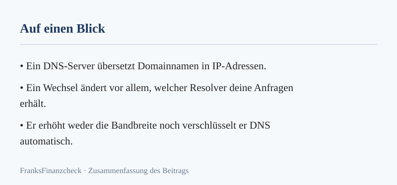
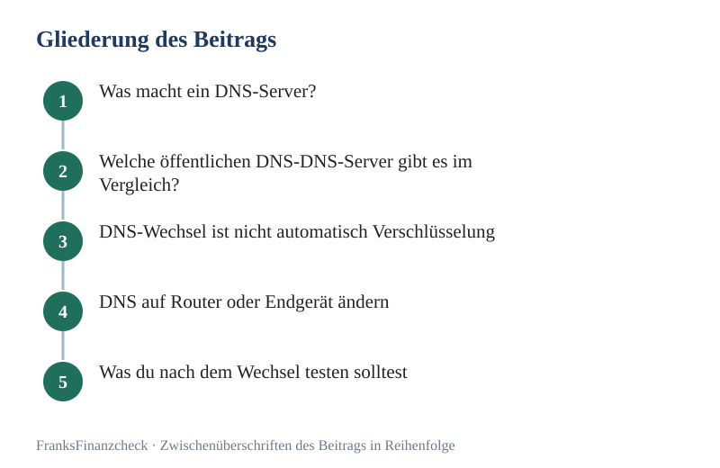

Wenn du den DNS-Server wechseln möchtest, änderst du zunächst den DNS-Server, an den dein Gerät seine Namensanfragen schickt. Das kann Filter, Datenschutzbedingungen und die Antwortzeit bei einer DNS-Abfrage beeinflussen. Es macht deinen Internetanschluss aber nicht automatisch schneller oder anonymer.

**Transparenz:** Dieser Artikel enthält Affiliate-Links (Werbung). Beim Abschluss über einen Link erhalten wir eine Provision – für dich entstehen keine Mehrkosten.

**Das Wichtigste in Kürze**

- DNS-Server übersetzen Domainnamen in IP‑Adressen, beeinflussen aber nicht die Bandbreite deines Anschlusses.  
- Öffentliche DNS-Server können DNS‑Anfragen verschlüsseln (DoH/DoT), schützen jedoch nicht vor allen Netzwerkdaten.  
- Filterfunktionen der Anbieter unterscheiden sich. Sie blockieren nur bekannte schädliche Domains und ersetzen keinen Virenschutz.  

*Abbildung: Merkkarte mit den Kernaussagen (eigene Darstellung aus diesem Beitrag).*

## Was macht ein DNS-Server?

DNS steht für Domain Name System. Ein DNS-Server übersetzt einen Domainnamen wie `example.de` in eine IP‑Adresse, die dein Gerät für den Verbindungsaufbau benötigt. Betriebssystem, Router und DNS-Server können Antworten zwischenspeichern. Deshalb wird nicht bei jedem Seitenaufruf eine neue DNS‑Anfrage gesendet.

Die DNS‑Auflösung ist nur ein Schritt vor der Verbindung zur Website. Ein anderer DNS-Server kann die Dauer dieses Schritts verändern, aber weder die vertragliche Bandbreite erhöhen noch ein schwaches WLAN reparieren. Das Ergebnis hängt unter anderem von deinem Anschluss, dem gewählten Dienst, der Route und dem Zwischenspeicher ab. Eine allgemeingültige Rangliste der schnellsten Anbieter gibt es für jeden Haushalt nicht.

## Welche öffentlichen DNS-DNS-Server gibt es im Vergleich?

Die folgenden IPv4‑Adressen stammen aus den aktuellen Anbieterunterlagen. Nutze für die zweite Adresse möglichst denselben Anbieter. So bleiben Filter‑ und Datenschutzregeln konsistent, falls dein Gerät beide DNS-Server verwendet.

| DNS-Server | Standard‑IPv4 | Schwerpunkt laut Anbieter |
|---|---|---|
| Cloudflare 1.1.1.1 | `1.1.1.1`, `1.0.0.1` | Standard ohne Inhaltsfilter. Optionale Familienvarianten filtern bekannte Malware‑ und Phishing‑Domains, teils auch Erwachseneninhalte |
| Google Public DNS | `8.8.8.8`, `8.8.4.4` | Öffentlicher DNS-Server. Googles Datenschutzseite beschreibt die Protokollierung von Anfragen |
| Quad9 Secure | `9.9.9.9`, `149.112.112.112` | Blockiert laut Quad9 DNS‑Anfragen an bekannte schädliche Domains |

### Cloudflare 1.1.1.1

Der Standardresolver löst DNS‑Anfragen ohne Inhaltsfilter auf. Für IPv6 nennt Cloudflare `2606:4700:4700::1111` und `2606:4700:4700::1001`. Die Varianten `1.1.1.2` und `1.0.0.2` filtern laut Anbieter bekannte Malware‑ und Phishing‑Domains. `1.1.1.3` und `1.0.0.3` ergänzen einen Filter für Erwachseneninhalte. Die entsprechenden IPv6‑Adressen sind `2606:4700:4700::1112` und `2606:4700:4700::1002`. Weitere Adressen lauten `2606:4700:4700::1113` und `2606:4700:4700::1003`.

Wenn dein Gerät IPv6 nutzt, trage auch bei DNSv6 die passende Filtervariante ein. Sonst können Anfragen über eine ungefilterte IPv6‑Adresse laufen. Diese Filter sind keine vollständige Sicherheitssoftware. Sie können erwünschte Domains blockieren. [Adressen und Filtervarianten](https://developers.cloudflare.com/1.1.1.1/ip-addresses/)

Cloudflare dokumentiert, dass der DNS-Server Anfragen verschlüsselt über DoH oder DoT entgegennehmen kann. Laut eigener Datenschutzbeschreibung werden bestimmte DNS-Server‑Protokolldaten nach kurzer Zeit gelöscht. Anonymisierte aggregierte Auswertungen können länger bestehen bleiben. Lies die [Details zur Protokollierung](https://developers.cloudflare.com/1.1.1.1/privacy/public-dns-resolver/), bevor du dich für den Dienst entscheidest.

### Google Public DNS

Die IPv6‑Adressen lauten `2001:4860:4860::8888` und `2001:4860:4860::8844`. Googles [Einrichtungsanleitung](https://developers.google.com/speed/public-dns/docs/using) erklärt die Konfiguration auf Routern und Endgeräten.

Googles Datenschutzseite beschreibt temporäre Protokolle, die IP‑Adresse und DNS‑Anfrage enthalten und nach kurzer Zeit gelöscht werden. Für Sicherheits‑ oder Missbrauchsfälle kann eine begrenzte längere Speicherung nötig sein. Daneben nennt Google dauerhafte, stichprobenbasierte Protokolle ohne Geräte‑IP, die unter anderem abgefragte Domains, technische DNS‑Daten und grobe Standortangaben auf Stadt‑ oder Regionsebene enthalten. Google erklärt, Daten aus Public DNS nicht für personalisierte Werbung zu verwenden. Prüfe die [aktuelle Datenschutzbeschreibung](https://developers.google.com/speed/public-dns/privacy), wenn diese Bedingungen für deine Wahl wichtig sind.

### Quad9

Die IPv6‑Adressen des Secure‑Dienstes sind `2620:fe::fe` und `2620:fe::9`. Quad9 beschreibt den Dienst als Schutz vor DNS‑Anfragen an bekannte schädliche Domains. Der Anbieter erklärt, keine personenbezogenen Nutzerdaten zu sammeln. Die konkreten [Dienstvarianten](https://docs.quad9.net/services/) und die [Datenschutzhinweise](https://quad9.net/service/privacy/) findest du bei Quad9. Auch ein DNS‑Filter ersetzt weder Updates noch Virenschutz oder umsichtiges Verhalten.

## DNS‑Wechsel ist nicht automatisch Verschlüsselung

Ein Wechsel von den DNS‑Adressen deines Internetanbieters zu einem öffentlichen DNS-Server ändert, wer die Anfrage bearbeitet. Wird klassisches DNS verwendet, kann die Anfrage auf dem Weg zum DNS-Server weiterhin unverschlüsselt sein. Ein bloßer Wechsel der IP‑Adresse verhindert daher nicht zuverlässig, dass dein lokales Netzwerk oder dein [Internetanbieter](../../posts/2026-10-07-dsl-anbieter-wechseln-warum-treue-dich-bares-geld-kostet/) DNS‑Anfragen einsehen kann.

DoH und DoT verschlüsseln die DNS‑Verbindung zwischen deinem Gerät beziehungsweise Router und dem gewählten DNS-Server. Das erschwert das Mitlesen auf diesem Übertragungsweg. Der DNS-Server selbst muss die Anfrage aber verarbeiten.

Außerdem bleiben andere Netzwerkdaten sichtbar, etwa die Verbindung zu einer Ziel‑IP und Zeitpunkt oder Umfang des Datenverkehrs. HTTPS schützt den Inhalt der Verbindung zur Website, macht dich aber nicht vollständig anonym.

Auch der Inkognitomodus ändert daran nichts: Er begrenzt vor allem, was der Browser lokal speichert. Google weist darauf hin, dass besuchte Websites und Netzwerkbetreiber wie Arbeitgeber oder Internetanbieter Aktivitäten dennoch beobachten können ([Chrome‑Hilfe](https://support.google.com/chrome/answer/95464?hl=de)).

## DNS auf Router oder Endgerät ändern

Notiere zuerst die bisherigen Einstellungen oder mache einen Screenshot. So kannst du bei Problemen zum vorherigen Zustand zurückkehren. Ändere DNS‑Einstellungen nicht auf einem verwalteten Arbeitsgerät oder in einem Firmennetz ohne Freigabe der IT.

### FRITZ!Box als Beispiel

Bei vielen FRITZ!Box‑Modellen findest du die DNS‑Einstellungen unter **Internet → Zugangsdaten** oder **Internet → Zugangsart → DNS‑Server**. Die Bezeichnungen und verfügbaren Optionen unterscheiden sich nach Modell, FRITZ!OS und Anbieter. Aktiviere die Verwendung anderer DNSv4‑ beziehungsweise DNSv6‑Server und trage die Adressen des gewählten Anbieters ein. Die [FRITZ! Knowledge Base](https://fritz.com/en-at/apps/knowledge-base/fritz-box-6591-cable/165_Configuring-different-DNS-servers-in-the-FRITZ-Box) beschreibt die Menüs für ein konkretes Modell.

Wenn du verschlüsselte Anfragen nutzen möchtest, reicht die Eingabe einer IP‑Adresse nicht immer aus. Bei DNS over TLS verlangt die FRITZ!Box zusätzlich den passenden Servernamen. Aktiviere diese Funktion nur, wenn dein Router und der gewählte DNS-Server sie unterstützen. Laut FRITZ! Kann die Box für einzelne Dienste weiterhin die DNS‑Server des Internetanbieters verwenden. Bei manchen Kabelanschlüssen fehlt die Einstellung ganz.

### Android und iPhone

Android unterstützt ab Version 9 **Privates DNS** mit verschlüsselten Anfragen. Je nach Gerät findest du die Einstellung unter **Einstellungen → Netzwerk & Internet → Privates DNS**. Für Cloudflare lautet der dokumentierte Hostname `one.one.one.one`. Android verwendet diese Einstellung laut [Cloudflare‑Anleitung](https://developers.cloudflare.com/1.1.1.1/setup/android/) auch in Mobilfunknetzen. Für andere Anbieter musst du den jeweiligen Hostnamen aus deren Anleitung verwenden. Menüs können je nach Hersteller anders heißen.

Auf dem iPhone lässt sich DNS für ein einzelnes WLAN unter **Einstellungen → WLAN → Info‑Symbol → DNS konfigurieren** manuell setzen. Diese Änderung gilt für das ausgewählte WLAN und wird nicht automatisch auf jedes andere Netz übertragen. Googles [Einrichtungsanleitung für iOS](https://developers.google.com/speed/public-dns/docs/using) zeigt die Schritte am Beispiel von Google Public DNS. Für andere Systeme nutze die jeweils aktuelle Anleitung des Geräte‑ oder DNS-Server‑Anbieters.

## Was du nach dem Wechsel testen solltest

Prüfe anschließend mehrere Websites und Apps. Teste auch Onlinebanking, VPN, Videokonferenzen, Smart‑Home‑Geräte und gegebenenfalls Jugendschutzfilter. Wenn eine Anwendung nicht mehr funktioniert, stelle zunächst die vorher notierten Einstellungen wieder her. Bei einer FRITZ!Box kannst du die DNS‑Adressen des Internetanbieters erneut automatisch beziehen lassen.

Mische nicht unbedacht DNS-Server mit unterschiedlichen Filtern als primäre und alternative Adresse. Je nach Gerät kann die zweite Adresse ebenfalls verwendet werden. Dadurch können Ergebnisse und Schutzregeln wechseln. In einem Firmen‑VPN oder bei lokalen Diensten kann außerdem ein vorgegebener DNS‑DNS-Server nötig sein.

**So gehst du vor**

1. Notiere die aktuellen DNS‑Einstellungen deines Routers oder Geräts (z. B. per Screenshot).  
2. Wähle den gewünschten öffentlichen DNS-Server und notiere dessen IPv4‑ beziehungsweise IPv6‑Adressen.  
3. Trage die neuen Adressen in den DNS‑Einstellungen deines Routers oder Endgeräts ein.  
4. Aktiviere, falls unterstützt, DNS over TLS oder [DNS over HTTPS](../../posts/2026-09-04-digitaler-turbo-warum-der-dns-hack-dein-netz-beschleunigt/) und gib den zugehörigen Servernamen an.  
5. Prüfe nach dem Speichern, ob die DNS-Abfrage funktioniert und ob gewünschte Filter greifen.  

**Faustregel:** Wer nur den primären DNS‑Server ändert und die alternative Adresse unverändert lässt, spart Zeit beim Testen, weil das System nicht zwischen zwei unterschiedlichen Filtern hin‑ und herwechselt.

## Kurzer Überblick für Einsteiger

DNS ist kurz erklärt. Jede Seite im Netz hat eine Nummer. Dein Browser kennt nur Namen. Ein DNS-Server übersetzt den Namen in die Nummer. Ohne diesen Schritt lädt keine Seite.

Du musst dafür kein Fachmann sein. Du musst nur wissen: Ein Wechsel ist einfach. Er ist in wenigen Minuten erledigt. Er lässt sich rückgängig machen. Und er ist kostenlos.

### Drei Dinge, die du beachten solltest

Erstens: Notiere die alten Einstellungen. Mach einen Screenshot. Schreibe die Nummern auf. So kannst du jederzeit zurück.

Zweitens: Nimm nicht irgendeinen DNS-Server. Nimm einen Anbieter mit klaren Datenschutzregeln. Anbieter in der Liste unten sind geprüft.

Drittens: Teste nach dem Wechsel. Öffne ein paar bekannte Seiten. Lädt alles wie erwartet? Dann ist alles gut. Lädt etwas nicht? Dann stell die alten Werte wieder her.

## Kleine Anleitung für den ersten Test

Du willst es ausprobieren? Dann brauchst du nur drei Dinge. Einen Computer. Ein Terminal. Und [fünf Minuten](../../posts/2026-09-20-finanzieller-puffer-wie-viel-notgroschen-ist-genug/) Zeit.

Öffne das Terminal. Gib den ersten Befehl ein. Drücke Enter. Schau auf die Zahl bei Query time. Notiere sie. Fertig.

Wiederhole das mit dem zweiten DNS-Server. Wiederhole das mit dem dritten. Vergleiche die Zahlen. Das ist schon der ganze Test.

### So deutest du das Ergebnis richtig

Zahlen lügen nicht. Sie brauchen aber Kontext. Ein einzelner Wert ist wenig wert. Mehrere Werte zusammen ergeben ein Bild.

Ist ein DNS-Server fünf Millisekunden schneller? Dann merkst du das im Alltag nicht. Ist er 50 Millisekunden schneller? Dann kann das spürbar werden.

Gibt es Timeouts? Dann ist dieser DNS-Server für dich keine gute Wahl. Nimm einen anderen. Stabilität geht vor Tempo.

## Fünf Sätze zum Mitnehmen

Wechseln ist leicht. Das Risiko ist niedrig. Der Nutzen ist oft spürbar. Die Einrichtung kostet Minuten. Die Wirkung hält Jahre.

Du brauchst dafür kein teures Abo. Du brauchst keine neue Hardware. Du brauchst keine Fachkenntnisse. Alles, was du brauchst, ist auf deinem Rechner schon da.

*Abbildung: Gliederung des Beitrags in seinen Zwischenüberschriften (eigene Darstellung).*

## Das ändert sich für dich

Dein Internet wird nicht plötzlich doppelt so schnell. Dein WLAN wird nicht automatisch besser. Dein Router bekommt keine neue Antenne. Aber die DNS-Abfrage wird schneller. Und das spürst du bei jedem Klick.

Jede Seite im Netz beginnt mit einer DNS-Abfrage. Jede. Ohne Ausnahme. Wenn diese Abfrage schneller läuft, beginnt alles andere früher. Der Rest bleibt gleich. Der Gewinn ist klein pro Seite. Er summiert sich über den Tag.
## Was tun, wenn es nicht klappt

Keine Panik. Das passiert. Ein DNS-Wechsel lässt sich rückgängig machen. Stell die alten Werte wieder ein. Fertig. Du verlierst nichts. Du kannst nichts kaputtmachen.

### Zwei einfache Schritte zurück

Erstens: Öffne die gleichen Einstellungen wie beim Wechsel. Zweitens: Gib die alten Nummern wieder ein. Speichern. Testen. Alles ist wie vorher.

Kein Datenverlust. Kein Abo. Kein Risiko. Das macht den Wechsel so einsteigerfreundlich.

## Mein Tipp für den Anfang

Teste zuerst zwei Anbieter. Nicht zehn. Nicht fünf. Zwei. Das reicht für den Anfang. Nimm Cloudflare und Quad9. Beide sind schnell. Beide sind kostenlos. Beide setzen auf Datenschutz. Wechsle zwischen beiden. Miss die Zeiten. Dann entscheidest du.
## Der erste Eindruck reicht

Du musst kein Netzwerkexperte sein. Du musst keine Zertifikate haben. Du musst nur drei Dinge machen: Einstellen. Testen. Vergleichen. Das ist alles.

Ein Wechsel ist keine Wissenschaft. Es ist eine Einstellung auf deinem Rechner. Mehr nicht.

## Letzter Hinweis

Mach dir keine Sorgen, wenn du etwas nicht sofort verstehst. Du wirst es sehen, wenn es funktioniert. Seiten bauen sich schneller auf. Das ist der beste Beweis. Und wenn nicht? Dann zurück auf Anfang. Kein Schaden.

Viel Spaß beim Testen.
Drei Sätze zum Mitnehmen. Es ist einfach. Es ist schnell. Es lohnt sich.

## Ein Wort zum Schluss

Probier es aus. Es kostet nichts. Es dauert nicht lang. Du kannst nur gewinnen.
## Häufige Fragen

### Wird mein Internet durch einen anderen DNS‑Server schneller?

Nicht zwingend. Ein DNS-Server kann die DNS-Abfrage in manchen Situationen beschleunigen oder verlangsamen. Er erhöht aber nicht die Bandbreite und verbessert kein Funkloch. Vergleiche mehrere Tage unter denselben Bedingungen, statt dich auf einen pauschalen Millisekundenwert zu verlassen.

### Kann mein Internetanbieter meine DNS‑Anfragen danach noch sehen?

Bei klassischem, unverschlüsseltem DNS kann ein Netzwerkbetreiber die Anfragen weiterhin mitlesen. Mit DoH oder DoT wird die Verbindung zum DNS-Server verschlüsselt. Der gewählte DNS-Server verarbeitet die Anfrage trotzdem. Auch andere Verbindungsdaten bleiben sichtbar.

### Welcher DNS‑Anbieter ist der beste?

Es gibt keinen für alle passenden Testsieger. Vergleiche Filter, Datenschutzbedingungen, Unterstützung für DoH oder DoT und die Kompatibilität mit deinen Geräten. Die schnellste Option kann je nach Anschluss und Standort unterschiedlich sein.

### Schützt ein DNS‑Filter vollständig vor Phishing und Schadsoftware?

Nein. Ein Filter kann laut Anbieter bekannte schädliche Domains blockieren. Er ersetzt aber weder Virenschutz noch Browser‑Schutz, Updates oder eine Prüfung verdächtiger Links. Auch Fehlblockaden sind möglich.

### Wie mache ich die Änderung rückgängig?

Trage die notierten vorherigen Adressen wieder ein oder stelle den automatischen DNS‑Bezug des Routers beziehungsweise Geräts wieder her. Wenn du vorher DoH oder DoT aktiviert hast, deaktiviere auch diese Option.

## Wenn die Verbindung langsam bleibt

Wenn Seiten trotz eines funktionierenden DNS-Servers langsam laden, prüfe zuerst WLAN‑Abdeckung, Router, Endgerät und Anschluss. DNS betrifft nur die DNS-Abfrage. Wie du Antwortzeiten verschiedener DNS-Server konkret misst, zeigt der Artikel [DNS-Hack testen](../../posts/2026-09-04-digitaler-turbo-warum-der-dns-hack-dein-netz-beschleunigt/). Wenn das WLAN selbst langsam bleibt, hilft oft ein einfacher [WLAN-Check](../../posts/2026-08-14-wlan-verbessern-so-bringst-du-speed-in-jede-ecke/). Falls du anschließend deinen Tarif prüfen möchtest, kannst du [DSL‑Angebote vergleichen](/go/dsl/). Der Vergleich betrifft den Internetvertrag, nicht die Leistung des DNS‑Servers.

*(Dieser Artikel enthält Affiliate‑Links (Werbung). Beim Abschluss über einen Link erhalten wir eine Provision – für dich entstehen keine Mehrkosten.)*

**Weiterlesen:** [Der Ratgeber Internet & DSL](../../pillar/internet-dsl/)

## Weiterrechnen und vertiefen

- **Rechner:** [Fixkosten-Scanner: alle laufenden Kosten, Internet inklusive, in einer Zahl](../../werkzeuge/fixkosten-scanner/)
