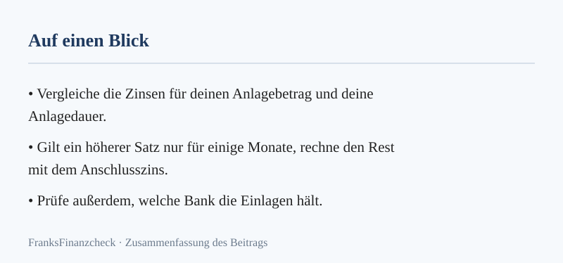

Tagesgeldkonto im Check: Zwei Banken werben mit unterschiedlichen Tagesgeldzinsen. Der höhere Satz gilt nur für neue Einlagen und endet nach wenigen Monaten. Welches Konto über ein Jahr mehr bringt, siehst du erst, wenn du den Zeitraum nach der Aktion mitrechnest. Eine Liste vermeintlicher Bestzinsen hilft dabei wenig: Zinssätze ändern sich, dein Bedarf an verfügbarem Geld nicht unbedingt.

**Transparenz:** Dieser Artikel enthält Affiliate-Links (Werbung). Beim Abschluss über einen Link erhalten wir eine Provision – für dich entstehen keine Mehrkosten.

*Abbildung: Merkkarte zu „Tagesgeld vergleichen: Was bleibt nach dem Aktionszins?“ (eigene Darstellung aus diesem Beitrag).*

## Wofür brauchst du das Geld?

Genau das ist der Hebel: Tagesgeldkonto.

Darum geht es hier konkret: Tagesgeldkonto.

Trenne deine Rücklage für unerwartete Ausgaben von Geld, dessen Verwendung bereits feststeht. Die nächste Jahresrechnung für die Versicherung ist beispielsweise keine Überraschung. Für einen [Notgroschen](../../posts/2026-09-09-notgroschen-die-wahrheit-ueber-das-finanzielle-polster/) zählt vor allem, dass du ohne Verkauf von Wertpapieren und ohne langfristige Bindung an ihn herankommst. Wie viel Rücklage zu deinem Haushalt passt, schätzt du mit dem [Notgroschen-Rechner](../../werkzeuge/notgroschen-rechner/) ab.

Tagesgeld eignet sich nicht zum Bezahlen an der Kasse. In der Regel überweist du zuerst auf das vereinbarte Referenzkonto. „Täglich verfügbar“ bedeutet nicht, dass eine Überweisung jederzeit sofort gutgeschrieben ist. Halte auf dem Girokonto genug für unmittelbar fällige Abbuchungen bereit.

## Ein Angebot richtig lesen

Notiere den **Jahreszinssatz**, den **Aktionszeitraum** und das **Guthaben, für das er gilt**. Prüfe, ob das Angebot an eine erstmalige Kontoeröffnung, zusätzlich eingezahltes Geld oder ein weiteres Produkt gebunden ist. Liegt ein Teil deiner Einlage über einer Betragsgrenze, rechne beide Teile getrennt.

Ein Aktionszins von 3 % pro Jahr für drei Monate bedeutet nicht 3 % Ertrag in drei Monaten. Und ein heute genannter variabler Anschlusszins ist für die Zeit nach der Aktion keine Zusage. Rechne deshalb mindestens eine zweite Variante mit niedrigerem Anschlusszins durch. Welche Kontoarten es gibt und worauf du bei Gebühren achtest, steht im Ratgeber [Konto & Karten](../../pillar/konto-karten/).

### Beispiel: Der Anschlusszins entscheidet mit

Angenommen, du legst 10.000 € für zwölf Monate an. Angebot A zahlt für drei Monate 3 % pro Jahr; für die übrigen neun Monate nehmen wir 1 % an. Angebot B zahlt in der Rechnung für das ganze Jahr 2 %. Alle Sätze sind **frei gewählte Modellannahmen**, keine Angebote. Wir rechnen vereinfacht in Monaten, ohne Steuern, Gebühren und Zinseszins.

| Zeitraum | Angebot A | Angebot B |
|---|---:|---:|
| Erste drei Monate | 10.000 € × 3 % × 3/12 = 75 € | 10.000 € × 2 % × 3/12 = 50 € |
| Weitere neun Monate | 10.000 € × 1 % × 9/12 = 75 € | 10.000 € × 2 % × 9/12 = 150 € |
| Bruttoertrag für zwölf Monate | **150 €** | **200 €** |

Wer nach drei Monaten über das Geld verfügen muss, stellt eine andere Frage als jemand, der ein ganzes Jahr vergleicht. Bei einer vorzeitigen Entnahme ändern sich die verzinsten Beträge; bei einer Zinsänderung ändert sich der zweite Teil der Rechnung. Der höhere erste Satz gewinnt also nicht automatisch.

## Rechenbeispiel: Was bringt das Tagesgeld konkret?

Das zweite Modell isoliert den Einfluss des Zinssatzes: **15.000 € Guthaben, zwölf Monate, keine Zu- oder Abflüsse, konstante Zinsen.** Bei 1,90 % entstehen 285 € Bruttozins; bei 3,10 % sind es 465 €. Der Unterschied zwischen diesen beiden Modellkonten beträgt 180 €, nicht 465 €. Die größere Differenz ergibt sich nur im Vergleich mit einem unverzinsten Konto. Unterjährige Zinsänderungen, Steuern und Zinseszins fehlen bewusst.





## Wer hält deine Einlage?

Nicht das Logo im Vergleichsportal, sondern das kontoführende Institut ist für die Zuordnung der Einlage entscheidend. Lies im Informationsbogen für Einleger nach, welche Bank Vertragspartner ist und welches Sicherungssystem zuständig ist. Mehrere Marken können zu demselben Institut gehören.

Die gesetzliche [Einlagensicherung](../../posts/2026-09-23-einlagensicherung-wie-viel-guthaben-geschuetzt-ist/) schützt grundsätzlich bis zu 100.000 € pro Person und Bank, nicht pro Konto. Guthaben bei derselben Bank werden für diese Grenze zusammen betrachtet. Für besondere Lebenssituationen können abweichende Regeln gelten. Im [Ratgeber zur Einlagensicherung](../../posts/2026-09-23-einlagensicherung-wie-viel-guthaben-geschuetzt-ist/) findest du die Einordnung. Eine hohe Verzinsung ersetzt diese Prüfung nicht.

## Was ein Prozentpunkt bei deinem Guthaben bedeutet

Auf einem Werbebanner wirkt ein Zinsunterschied von einem halben Prozentpunkt leicht größer, als er für eine kleine Rücklage ist. Bei 2.000 € unverändertem Guthaben macht er über ein volles Jahr rechnerisch 10 € brutto aus: 2.000 € × 0,005. Für drei Monate sind es vereinfacht 2,50 €. Bei 20.000 € wären die Beträge zehnmal so hoch. Entscheide anhand der Differenz in Euro, ob sich eine weitere Kontoeröffnung für dich lohnt.

Ein Kontowechsel hat keinen einheitlichen Wert für alle Haushalte. Wenn du Anmeldedaten, Referenzkonto und Steuerunterlagen für mehrere Banken verwalten musst, ist das ein zusätzlicher Aufwand. Bei größeren Einlagen lohnt dagegen ein genauer Blick auf die Verteilung und die Sicherungsgrenzen, selbst wenn die Zinssätze ähnlich sind. Das eine ist eine Ertragsfrage, das andere eine Sicherheitsfrage.

*Abbildung: Gliederung zu „Tagesgeld vergleichen: Was bleibt nach dem Aktionszins?“ – 5 Stationen von „Wofür brauchst du das Geld?“ bis „Was ein Prozentpunkt bei deinem Guthaben bedeutet“ (eigene Darstellung).*

## Wenn sich das Guthaben verändert

Die einfache Jahresrechnung setzt einen gleichbleibenden Betrag voraus. Für eine Rücklage, die du erst aufbaust, gilt das nicht. Angenommen, am Jahresanfang liegen 4.000 € auf dem Konto, nach sechs Monaten kommen weitere 2.000 € hinzu. Bei einem angenommenen Jahreszins von 2 % entstehen für die ersten sechs Monate 40 € brutto und für die zweiten sechs Monate 60 €. Zusammen sind das rund 100 €, ohne Zinseszins und bei vereinfachter Monatsrechnung.

Wer stattdessen 6.000 € mit 2 % multipliziert, kommt auf 120 € und überschätzt den Ertrag. Der zusätzliche Betrag war nicht das ganze Jahr angelegt. Dasselbe gilt umgekehrt, wenn eine Reparatur ansteht und du Geld abhebst. Der täglich verfügbare [Notgroschen](../../posts/2026-09-09-notgroschen-die-wahrheit-ueber-das-finanzielle-polster/) erfüllt seinen Zweck gerade dann, wenn du ihn brauchst; weniger Zinsen nach einer Entnahme sind kein Fehler der Bank.

## Fallstrick: Der Aktionszins gilt nur für einen Teilbetrag

Ein hypothetisches Angebot zahlt 3 % pro Jahr für höchstens 10.000 € und 1 % für den darüberliegenden Anteil. Legst du 15.000 € für ein ganzes Jahr an und bleiben die Sätze unverändert, erhältst du 300 € auf die ersten 10.000 € und 50 € auf die übrigen 5.000 €. Insgesamt sind das 350 € brutto. Die Anzeige „3 %“ auf das gesamte Guthaben anzuwenden ergäbe dagegen 450 € und wäre für diesen Fall falsch.

Ähnlich wichtig ist die Definition von neuem Geld. Manchmal gilt die Aktion nur für Beträge oberhalb eines früheren Kontostands oder nur für Einzahlungen von einer anderen Bank. Notiere, welcher Stichtag im Angebot steht. Eine Umbuchung zwischen zwei eigenen Konten beim selben Institut erfüllt eine solche Bedingung nicht schon deshalb, weil das Geld für dich auf einem neuen Konto liegt.

## Festgeld als Alternative richtig einordnen

Ein fester Zinssatz und täglich verfügbares Geld erfüllen verschiedene Bedürfnisse. Beim Festgeld bindest du den Betrag für die vereinbarte Laufzeit. Lies vor Abschluss, wie die Auszahlung funktioniert und ob ohne rechtzeitige Weisung eine Verlängerung erfolgt. Ein höherer Jahresertrag nützt wenig, wenn du während der Laufzeit für eine unerwartete Rechnung einen teuren Kredit brauchst.

Teile das Geld gedanklich in konkrete Aufgaben. Den Betrag für eine in wenigen Wochen fällige Rechnung brauchst du verlässlich auf dem Zahlungskonto. Eine Reserve für unvorhersehbare Ausgaben soll kurzfristig erreichbar sein. Nur für den Teil, auf den du tatsächlich länger verzichten kannst, stellt sich die Frage nach einer Bindung. Wie groß diese Teile ausfallen, hängt von deinen Ausgaben und Einkünften ab, nicht von einer allgemeingültigen Quote.

## Beim Vergleich mit einem Vermittlungsportal

Ein Portal kann die Eröffnung erleichtern, ist aber nicht zwingend die Bank, bei der dein Guthaben liegt. Ordne die Beteiligten vor der ersten Überweisung zu: Wer vermittelt, wer führt das Verrechnungskonto, wer nimmt die Einlage an, und an welche Stelle wendest du dich bei Problemen? Die Firmenbezeichnungen findest du in den Vertragsunterlagen. Verlasse dich nicht allein auf ein Markenlogo oder ein Werbeversprechen zur Sicherheit.

Prüfe die Kontodaten über deinen selbst aufgerufenen, gesicherten Zugang. Eine Nachricht, die kurzfristig eine abweichende Überweisungsadresse verlangt oder mit dem sofortigen Ende des Angebots droht, ist kein Anlass, schneller zu überweisen. Kläre den Vorgang über eine bereits bekannte Kontaktmöglichkeit, bevor du Geld bewegst. Für ein Tagesgeldangebot musst du niemandem die Kontrolle über deinen Bildschirm überlassen.

## Nach der Eröffnung: Zinsen und Zugriff kontrollieren

Bewahre den Nachweis über die vereinbarten Konditionen zusammen mit dem Datum der ersten Einzahlung auf. Kontrolliere beim ersten Zinsabschluss den Zeitraum und die Wertstellungen. Ein als Jahreszins angegebener Satz ist nicht der Betrag, der jeden Monat gutgeschrieben wird. Bei wechselnden Guthaben oder taggenauer Berechnung kann eine echte Abrechnung von der vereinfachten Monatsrechnung im Beispiel abweichen.

Sieh dir den Bruttobetrag und den tatsächlich gutgeschriebenen Betrag getrennt an. Persönliche Steuermerkmale und die bei der Bank hinterlegten Angaben können den Auszahlungsbetrag beeinflussen. Bei mehreren Konten hilft eine Übersicht über die dort erteilten Freistellungsaufträge. Ein bloßer Vergleich zweier Nettogutschriften reicht nicht aus, um Rückschlüsse auf die Qualität der Verzinsung zu ziehen.

## Vor der Kontoeröffnung

1. **Konditionen sichern.** Speichere das Preisverzeichnis und die Bedingungen der Zinsaktion mit Datum. Ein Werbebanner allein reicht für die spätere Kontrolle nicht.
2. **Kosten zusammenzählen.** Ist ein zusätzliches Girokonto nötig, gehören dessen mögliche Gebühren in deinen Vergleich. Prüfe auch Bedingungen für das Referenzkonto.
3. **Verfügbarkeit klären.** Wie änderst du ein Überweisungslimit? Wie erreichst du die Bank, wenn du den Zugang verlierst? Das ist gerade bei einer Notfallrücklage wichtig.
4. **Wiedervorlage setzen.** Notiere das Ende der Zinsgarantie. Entscheide dann anhand der neuen Konditionen, statt einen Kontowechsel allein wegen eines Lockangebots zu planen.

**Falls du ein Angebot prüfen möchtest:** Beim [Tagesgeldangebot der C24 Bank (Affiliate-Link)](/go/tagesgeld/) gelten die unmittelbar vor Abschluss ausgewiesenen Konditionen.

Das Angebot steht hier nicht stellvertretend für den Markt. Rechne mindestens eine Alternative mit demselben Betrag und Zeitraum durch.

**Weiterlesen:** [Ratgeber Konto & Karten](../../pillar/konto-karten/) · [Notgroschen-Rechner](../../werkzeuge/notgroschen-rechner/)
