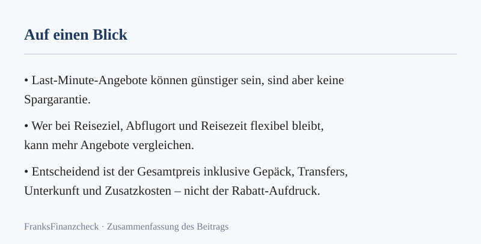
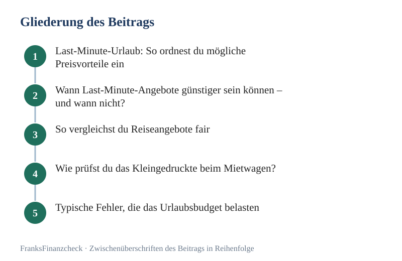

*Abbildung: Merkkarte zu „Last Minute Urlaub: So findest du echte Reiseschnäppchen“ (eigene Darstellung aus diesem Beitrag).*

## Last-Minute-Urlaub: So ordnest du mögliche Preisvorteile ein

Kurzfristige Angebote können günstiger sein. Doch ein Preisvorteil ist nicht planbar. Eine 2026 von WELT zitierte Verbraucherexpertin hält die mögliche Ersparnis für schwer vorhersehbar. Nachlässe von bis zu 50 Prozent seien Einzelfälle. Sie sind keine verlässliche Erwartung ([Einordnung zu Last-Minute-Angeboten](https://www.welt.de/reise/article6a327762e495aff7b58467a5/last-minute-urlaub-winken-wirklich-die-besten-schnaeppchen-wenn-man-auf-den-letzten-druecker-bucht.html)).

**Transparenz:** Dieser Artikel enthält Affiliate-Links (Werbung). Beim Abschluss über einen Link erhalten wir eine Provision – für dich entstehen keine Mehrkosten.

Der Deutsche Reiseverband definiert Last Minute so: höchstens 14 Tage zwischen Buchung und Abreise. Das ZDF gibt diese Definition wieder. Portale verwenden den Begriff teilweise breiter. Verlasse dich deshalb nicht auf die Überschrift des Angebots. Prüfe Abreise, Leistungen und Vertragsbedingungen ([ZDF-Ratgeber](https://www.zdfheute.de/ratgeber/last-minute-urlaub-angebote-sommer-100.html)).

**Das Wichtigste in Kürze**  
- **Keine Spargarantie:** Kurzfristige Angebote können günstiger sein, müssen es aber nicht.
- **Flexibilität hilft bei der Auswahl:** Verschiebbare Termine und mehrere Abflughäfen schaffen mehr Vergleichsmöglichkeiten.
- **Gesamtpreis statt Rabatt-Aufdruck:** Rechne Extras, Transfers, Verpflegung und Stornobedingungen mit.
- **Mietwagen separat prüfen:** Kaution, Selbstbehalt, Kraftstoffregel und Zusatzfahrer verändern den Endpreis.
- **In Ruhe vergleichen:** Ein Preisalarm ist ein Hinweis, aber kein Beleg für den niedrigsten verfügbaren Preis.

## Wann Last-Minute-Angebote günstiger sein können – und wann nicht?

Ein Preisvorteil kann entstehen, wenn kurz vor der Abreise noch Plätze oder Zimmer frei sind. Das ist aber keine feste Preisregel. Anbieter können Angebote [reduzieren](../../posts/2026-10-12-haushaltskosten-reduzieren-so-gewinnst-du-die-kontrolle/). Sie können sie unverändert lassen. Sie können sie bei hoher Nachfrage auch verteuern. Auch eine vermeintliche Ersparnis ist nur dann aussagekräftig, wenn Reisezeit, Unterkunft, Verpflegung, Gepäck und Umbuchungsbedingungen vergleichbar sind.

Flexibilität verbessert vor allem deine Auswahl. Sie garantiert weder einen freien Platz noch den günstigsten Preis. In Ferienzeiten oder auf beliebten Strecken kann die Auswahl kleiner sein. Prüfe deshalb zuerst, welche Bedingungen für dich unverzichtbar sind. Danach vergleiche mehrere passende Angebote.

| Situation | Was sie dir bringen kann | Was du zusätzlich prüfen solltest |
|---|---|---|
| Ziel und Abflughafen sind flexibel | Mehr passende Angebote im Vergleich | Anreise zum alternativen Flughafen und Transferkosten |
| Reisetermin ist verschiebbar | Andere Preise und Verfügbarkeiten werden sichtbar | Urlaubstage, Schulferien und Unterkunftsbedingungen |
| Abreise steht kurz bevor | Noch freie Kontingente können angeboten werden | Gültige Reisedokumente, Zahlungsfrist und Stornoregeln |
| Angebot wirkt stark reduziert | Der Einstiegspreis kann niedriger sein | Gesamtpreis, enthaltene Leistungen und Vergleichspreis |

### Mögliche Nachteile

* **Eingeschränkte Auswahl:** Wunschhotel, Abflugort oder passende Zimmerkategorie können bereits ausgebucht sein.
* **Wenig Vorbereitungszeit:** Dokumente, Visa, Anreise und notwendige Buchungsbestätigungen müssen trotzdem stimmen.
* **Schwer planbarer Preis:** Ein günstiges Angebot kann auftauchen, aber weder Zeitpunkt noch Höhe eines Rabatts sind verlässlich vorherzusagen.

## So vergleichst du Reiseangebote fair

Nutze Vergleichsportale, um mögliche Termine, Ziele und Anbieter zu entdecken. Ein Portal bildet aber nicht alle Leistungen oder Anbieter ab. Öffne deshalb das konkrete Angebot beim Veranstalter. Vergleiche denselben Reisezeitraum, dieselbe Personenanzahl und dieselben Leistungen.

Setze vor der Suche ein Gesamtbudget. Prüfe bei jedem Treffer, ob der angezeigte Einstiegspreis für deine Reisedaten gilt. Prüfe, welche Kosten hinzukommen. Ein Rabatt-Aufdruck ersetzt diesen Vergleich nicht.

### Praktische Werkzeuge

| Werkzeug | Wofür es hilfreich ist | Grenze |
|---|---|---|
| **Preisalarme** | Preisänderungen für gespeicherte Strecken oder Termine beobachten | Melden nicht zwingend jeden Anbieter und versprechen keinen Tiefstpreis |
| **Flexible Datumssuche** | Benachbarte Abreisetage vergleichen | Die günstigere Verbindung kann zusätzliche Anreise- oder Übernachtungskosten auslösen |
| **Karten- und Zielsuchen** | Alternativen sichtbar machen, wenn das Reiseziel offen ist | Ausstattung und Vertragsbedingungen musst du beim Anbieter prüfen |
| **Privatmodus oder VPN** | Privatsphäre beim Surfen erhöhen | Garantieren keinen niedrigeren Reisepreis. Rechne nicht mit einem festen Rabatt |

### Gesamtpreis statt Lockpreis

| Kostenpunkt | Was du vor dem Buchen vergleichst |
|---|---|
| **Anreise** | Flug oder Fahrt, Gepäck, Sitzplatz, Parken und mögliche Transfers |
| **Unterkunft** | Verpflegung, Reinigung, Resort- oder Tourismusgebühren und Lage |
| **Mobilität** | Mietpreis, Kaution, Kraftstoffregel, Kilometergrenze und Zusatzfahrer |
| **Buchungsbedingungen** | Zahlungsfrist, Storno, Umbuchung und enthaltene Absicherung |

Die Zahlen auf einer Angebotsseite sind nur dann vergleichbar, wenn diese Bestandteile für beide Angebote gleich behandelt werden. Fehlen Angaben? Dann frage nach. Oder rechne mit dem höheren Gesamtbetrag, bevor du dich entscheidest.

## Wie prüfst du das Kleingedruckte beim Mietwagen?

Ein Mietwagen kann den Reisepreis spürbar verändern. Vergleiche deshalb den Gesamtpreis für denselben Zeitraum und dieselbe Fahrzeugklasse. Die Höhe und Art der Kaution hängen von Anbieter, Station, Fahrzeug und Zahlungsart ab. Ein Kartenlimit kann während der Miete teilweise blockiert sein. Verlasse dich nicht auf einen pauschalen Kautionsbetrag. Prüfe die Bedingungen des konkreten Angebots.

Achte zusätzlich auf Selbstbeteiligung, Versicherungsschutz und Kilometergrenze. Denk an Zusatzfahrer, Kindersitz, Abholzeit und Tankregel. Extras, die erst am Schalter auffallen, können den vermeintlich günstigen Grundpreis verändern.

### Tipps zum fairen Mietwagenvergleich

1. **Abholstationen vergleichen** – Beziehe Anfahrt, Transfer und mögliche Standortgebühren in den Gesamtpreis ein.
2. **Passende Fahrzeugklasse wählen** – Prüfe Platz für Personen und Gepäck sowie den erwarteten Verbrauch auf deiner Strecke.
3. **Tankregel prüfen** – Vergleiche die angebotenen Modelle und mögliche Gebühren für die Rückgabe mit leerem Tank.
4. **Kreditkartenschutz nachlesen** – Eine Kreditkarte ersetzt nicht automatisch die Mietwagenversicherung. Prüfe Geltungsbereich, Selbstbehalt, Ausschlüsse und vorgeschriebene Zahlungsart.

## Typische Fehler, die das Urlaubsbudget belasten

**Nur auf den Startpreis schauen.** Das geht meist schief. Gepäck, Transfer und Verpflegung kommen oft dazu. Auch eine ungünstige Tankregel kann teuer werden. Rechne immer den Endpreis. Für alle Mitreisenden.

**Ein Preisalarm als Tiefstpreis-Garantie verstehen.** Das ist ein Irrtum. Ein Alarm meldet beobachtete Änderungen. Er kennt nicht jedes Angebot. Vergleiche den Treffer mit ähnlichen Leistungen. Buche nicht allein wegen Zeitdruck.

**Storno und Umbuchung übersehen.** Das wird teuer. Prüfe Fristen und Gebühren vor der Zahlung. Bei kurzfristigen Reisen bleibt wenig Zeit. Fehlende Dokumente lassen sich dann kaum noch klären. Abweichende Bedingungen auch nicht.

## Budget-Strategien für Last-Minute-Reisen

* **Punkte und Guthaben prüfen** – Vergleiche den Gegenwert einer Einlösung mit dem Barpreis. Achte auf mögliche Gebühren oder Einschränkungen.
* **Versicherungsschutz abgleichen** – Prüfe zuerst bestehende Policen und Kreditkartenleistungen. Ein Jahresschutz kann für häufiges Reisen passen. Er ist aber nicht automatisch günstiger oder umfassender.
* **Zahlungswährung beachten** – Lies die Gebühren deiner Karte. Vergleiche die Abrechnung in Landeswährung mit einer vom Händler angebotenen Umrechnung.
* **Gemeinsame Kosten fair teilen** – Ein Mietwagen oder eine Unterkunft kann pro Person günstiger werden. Das klappt, wenn die Gruppe die Gesamtkosten und Bedingungen gemeinsam prüft.

## So gehst du vor: Schritt für Schritt zum passenden Angebot

Lege fest, welche Termine, Ziele und Abflughäfen du akzeptierst. Bestimme danach dein Höchstbudget für die ganze Reise. Nicht nur für Flug oder Unterkunft. So kannst du schnell entscheiden. Du brauchst keinen Rabatt-Prozentsatz als Maßstab.

Vergleiche nur Angebote mit ähnlichen Leistungen. Prüfe bei Mietwagen Kaution, Versicherung und Tankregel separat. Lies vor der Zahlung die Buchungs-, Storno- und Umbuchungsbedingungen. Sichere die Bestätigung.

### Schritt-Liste im Detail

1. **Rahmen festlegen** – Notiere mögliche Termine, Abflughäfen, Zielregionen und die Zahl der Reisenden.
2. **Gesamtbudget setzen** – Rechne Anreise, Unterkunft, Gepäck, Transfers, Verpflegung und mögliche Extras ein.
3. **Angebote vergleichen** – Nutze mehrere Portale als Einstieg und prüfe das konkrete Angebot beim Anbieter.
4. **Leistungen angleichen** – Vergleiche gleiche Reisedauer, Zimmer, Verpflegung und Gepäckregeln.
5. **Bedingungen prüfen** – Lies Zahlungsfrist, Storno, Umbuchung und die Namen der Vertragspartner.
6. **Mietwagen separat rechnen** – Beziehe Kaution, Selbstbeteiligung, Tankregel und Zusatzfahrer ein.
7. **Unterlagen sichern** – Speichere Buchungsbestätigung, Leistungsbeschreibung und Kontaktdaten.

## Rechenbeispiel: So vergleichst du den Gesamtpreis

Die folgenden Zahlen sind frei gewählte Rechenannahmen und keine aktuellen Marktpreise. Angebot A kostet 500 € für Flug und Unterkunft, dazu kommen 60 € für Gepäck und 40 € für Transfers: zusammen 600 €. Angebot B kostet 540 € und enthält das Gepäck. Der Transfer kostet 20 €: zusammen 560 €.

Auf dieser Annahme wäre Angebot B um 40 € günstiger. Das gilt nur, wenn Reisedauer, Unterkunft, Verpflegung und Stornobedingungen ebenfalls vergleichbar sind. Ein niedrigerer Einstiegspreis allein reicht nicht für die Entscheidung.

## Checkliste vor der Buchung

- [ ] Gesamtbudget für alle Reisenden festgelegt
- [ ] Gepäck, Verpflegung, Transfers und weitere Extras eingerechnet
- [ ] Reisedaten und Leistungen der Angebote miteinander vergleichbar
- [ ] Zahlungsfrist sowie Storno- und Umbuchungsbedingungen gelesen
- [ ] Reisedokumente und Einreisevorgaben geprüft
- [ ] Mietwagen-Kaution und Kreditkartenlimit abgeglichen, falls relevant
- [ ] Versicherungsschutz und Ausschlüsse anhand der Vertragsbedingungen geprüft
- [ ] Buchungsbestätigung und Kontaktdaten gespeichert

*Abbildung: Gliederung zu „Last Minute Urlaub: So findest du echte Reiseschnäppchen“ – 5 Stationen von „Last-Minute-Urlaub: So ordnest du mögliche Preisvorteile ein“ bis „Typische Fehler, die das Urlaubsbudget belasten“ (eigene Darstellung).*

## Kurzer Merksatz vor der Reise

Buchen soll Spaß machen. Es soll dich nicht in Kosten stürzen. Drei Sätze reichen als Regelwerk.

Erstens: Rechne den Gesamtpreis. Zweitens: Lies die Bedingungen. Drittens: Vergleiche in Ruhe. Das ist schon die halbe Miete.

### Was du nicht tun solltest

Buche nicht in Hektik. Buche nicht, weil der Countdown auf der Seite läuft. Buche nicht, ohne den Endpreis zu kennen. Buche nicht, wenn die Stornobedingungen unklar sind. Das sind die vier typischen Fehler. Sie sind leicht zu vermeiden.

### Der beste Zeitpunkt zum Buchen

Der beste Zeitpunkt ist nicht der letzte Tag. Er ist auch nicht drei Monate im Voraus. Er ist der Moment, in dem du den Gesamtpreis kennst. In dem du die Bedingungen gelesen hast. In dem du mit anderen Angeboten verglichen hast.

Das kann zwei Wochen vor Abreise sein. Das kann auch zwei Tage vor Abreise sein.

### Mietwagenpreise separat vergleichen

Brauchst du am Reiseziel einen Mietwagen, vergleiche für deine Reisedaten den Gesamtpreis. Dieser Partnervergleich betrifft ausschließlich Mietwagen, nicht Flug, Pauschalreise oder Unterkunft. Prüfe vor der Buchung zusätzlich Kaution, Selbstbeteiligung, Tankregel und Zahlungsbedingungen.

[**Mietwagenpreise vergleichen**](/go/mietwagen/)

*(Werbelink: Beim Abschluss über diesen Link erhalten wir eine Provision. Für dich entstehen keine Mehrkosten.)*

**Weiterlesen:** [Ratgeber Mietwagen](../../pillar/mietwagen/) **Lesetipp:** [September-Roadtrip: Clevere Wege zum Mietwagen-Schnäppchen](../../posts/2026-09-02-september-roadtrip-clevere-wege-zum-mietwagen-schnaeppchen/)

## Kurzer Check vor der Buchung

Drei Fragen. Drei Antworten. Und schon weißt du, ob das Angebot taugt.

Frage eins: Was kostet die Reise insgesamt? Alles inklusive? Oder kommt noch etwas dazu?

Frage zwei: Kann ich stornieren? Und wenn ja, zu welchen Bedingungen?

Frage drei: Bin ich flexibel genug für dieses Angebot? Kann ich mit den Einschränkungen leben?

Wenn alle drei Antworten stimmen, kannst du buchen. Wenn eine Antwort unstimmig ist, schlaf eine Nacht darüber.

### Der Fehler mit dem Druck

Viele Seiten zeigen einen Countdown. Er soll Druck machen. Er ist ein Marketingmittel. Er ist selten echt. Lass dich davon nicht treiben.

Ein gutes Angebot kommt wieder. Eine schlechte Buchung bleibt.

### Nach der Buchung

Druck die Bestätigung aus. Speichere sie als PDF. Prüfe noch einmal das Datum. Prüfe den Namen. Prüfe die Anzahl der Reisenden. So [vermeidest](../../posts/2026-10-05-bueroausstattung-steuerlich-clever-absetzen-so-vermeidest/) du böse Überraschungen am Schalter.

Und dann? Dann freu dich auf die Reise. Du hast gut verglichen. Du hast fair gebucht. Das ist gutes Reise-Gefühl.

## Wenn du dich unsicher fühlst

Lass es. Gute Reisen buchen sich nicht unter Druck. Wenn der Preis stimmt, aber dein Bauch nein sagt, hör auf ihn. Es gibt immer ein anderes Angebot oder einen anderen Tag. Du entscheidest. Kein Countdown. Kein Pop-up. Kein Verkäufer. Nur du.

## Kurze Tipps für den Buchungs-Check

Prüfe den Namen. Prüfe das Datum. Prüfe den Flughafen. Ein Tippfehler kann teuer werden. Ein falscher Tag auch. Ein falscher Flughafen auch. Das sind Kleinigkeiten. Sie kosten schnell viel Geld. Nimm dir zehn Sekunden Zeit.

## Danke fürs lesen

Bis hierhin hast du die wichtigsten Regeln. Du weißt, [worauf du achten](../../posts/2026-08-18-wohngebaeudeversicherung-vergleich-worauf-du-achten-musst/) musst. Du weißt, wo Fallen lauern. Du weißt, wie du fair vergleichst. Das ist viel mehr als das, was viele Schnellbucher wissen.

Buche klug. Buche fair. Und hab eine schöne Reise.

**Faustregel:** Vergleiche vor der Buchung den Gesamtpreis aus Flug, Unterkunft, Gepäck, Transfer und Versicherung gemeinsam – der prozentuale Rabatt auf dem Banner sagt nichts über den Endpreis.

## Häufige Fragen

### Wie kurzfristig kann ich noch buchen?
Manche Angebote sind auch kurz vor der Abreise verfügbar. Wie viel Zeit zwischen Buchung und Reise liegt, hängt vom Angebot ab. Der Deutsche Reiseverband nennt 14 Tage als Grenze. Ein kurzer Vorlauf sagt nichts Verlässliches über den Preis aus.

### Welche Destinationen bieten die größten Rabatte?
Eine feste Rangliste gibt es nicht. Preise und Auswahl hängen von Termin, Abflughafen, Nachfrage und freien Kapazitäten ab. Vergleiche mehrere Ziele nur dann, wenn Anreise und Leistungen in deiner Gesamtrechnung enthalten sind.

### Ist ein Last-Minute-Urlaub abgesichert?
Bei einer Pauschalreise muss der Veranstalter eine Insolvenzsicherung nachweisen. § 651r BGB regelt den Sicherungsschein. Er regelt die Erstattung oder Rückbeförderung im Insolvenzfall ([Gesetzestext](https://www.gesetze-im-internet.de/bgb/__651r.html)). Das ist kein allgemeiner Schutz vor Wetter, Krankheit oder jeder Änderung.

### Wie viel Kaution sollte ich für einen Mietwagen einplanen?
Der Betrag hängt vom Anbieter, Fahrzeug, Tarif und der Station ab. Prüfe die konkrete Mietbedingung. Stelle sicher, dass dein Kartenlimit eine mögliche Reservierung verkraftet.

### Gibt es Last Minute auch mit All-inclusive?
Ja, solche Angebote gibt es. Vergleiche, welche Mahlzeiten, Getränke und Zusatzleistungen enthalten sind. Prüfe, ob der Gesamtpreis zu deinen Plänen passt.

### Kann ich meine Buchung nachträglich ändern?
Das hängt vom Vertrag und dem gebuchten Tarif ab. Es gibt keine einheitliche Umbuchungsfrist. Es gibt keine Pauschalgebühr für alle Anbieter. Lies die Bedingungen vor der Zahlung. Sichere sie zusammen mit der Bestätigung.

### Was tun, wenn das Wetter plötzlich schlecht ist?
Schlechtes Wetter begründet nicht automatisch ein Recht auf kostenfreie Umbuchung. Maßgeblich sind die Buchungsbedingungen. Bei Flugausfällen oder erheblichen Änderungen gelten die jeweiligen Fahrgastrechte. Wende dich an den Anbieter. Dokumentiere seine Antwort.

### Lohnt sich Last Minute für Familien?
Das kann passen, wenn Termine, Abflughafen und Unterkunft flexibel sind. Prüfe, ob Preis und Zimmer alle Reisenden einschließen. Prüfe Zusatzkosten für Gepäck, Transfers oder Betreuung.

### Wie vergleiche ich Angebote richtig?
Gleiche Reisedaten, Personenzahl, Unterkunft, Verpflegung und Gepäck ab. Vergleiche danach den Gesamtpreis und die Stornobedingungen. Nicht nur den Rabatt-Aufdruck.

### Was ist mit Versicherung?
Prüfe zunächst vorhandene Policen und Kartenleistungen. Entscheidend sind versicherte Personen, Deckung, Selbstbehalt, Ausschlüsse und Fristen. Eine Jahrespolice kann bei häufigen Reisen passen. Sie ist aber nicht automatisch günstiger oder umfassender.

### Kurzer Merksatz vor der Buchung
Nimm dir Zeit. Der Rabatt auf dem Banner ist selten der echte Preis. Rechne nach. Frag nach. Vergleiche in Ruhe. So buchst du günstig. Und so [vermeidest](../../posts/2026-10-05-bueroausstattung-steuerlich-clever-absetzen-so-vermeidest/) du Überraschungen nach der Reise.

## Weiterrechnen und vertiefen

- **Rechner:** [24-Monats-Effektivpreis-Rechner: Was der Tarif wirklich kostet](../../werkzeuge/effektivpreis-rechner/)
