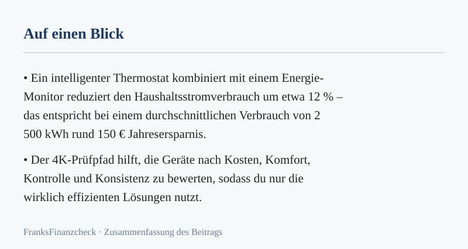
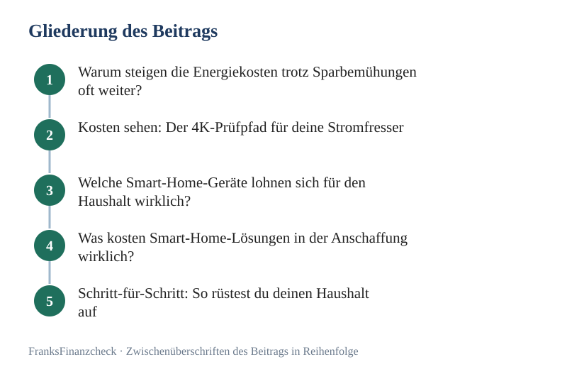

Der Herbst beginnt. Mit ihm startet die Heizperiode. Viele Haushalte blicken nun mit Sorge auf ihren Zähler.

Unbemerkte Stromfresser und falsch eingestellte Heizungen treiben deine **Energiekosten** unnötig in die Höhe. Sparen smarte Thermostate wirklich viel Heizkosten? Das hängt von deinem Verhalten und der Gerätewahl ab. Eine Rechnung mit klaren Annahmen zeigt dir, worauf es ankommt.

Du kannst diese Ausgaben kontrollieren, ohne auf Komfort zu verzichten. Bestimmte **Smart-Home-Geräte** bieten dir eine echte Ersparnis. Andere Produkte sind dagegen oft nur teure Spielerei. Erfahre hier, wie du dein Fixkosten-Cockpit digital aufrüstest und worauf du bei der Technik achtest.

Welche Geräte sparen im Alltag wirklich messbar Strom? Ab wann rechnen sich die Kosten für die vernetzte Technik? Wie integrierst du diese Tools in dein persönliches Budget, um langfristig Kurs zu halten?

**Das Wichtigste in Kürze**
* **Heizungssteuerung:** Smarte Thermostate können Heizkosten einsparen. Die Spanne von 10 bis 25 % ist ein Beispielwert aus der Rechnung unten. Keine Festzusage.
* **Transparenz:** Intelligente Steckdosen entlarven Standby-Sünder in deinem Haushalt.
* **Amortisation:** Einfache Systeme rechnen sich oft schon nach der ersten Heizperiode.
* **Strategie:** Prüfe regelmäßig deine Verträge. Das bleibt unerlässlich für dein Fixkosten-Cockpit.

---

💡 **Schnell-Tipp von FranksFinanzcheck:** Die besten Tarife findest du über unseren Partner-Vergleich: [**Jetzt Stromtarife vergleichen**](/go/strom/)
_(Dieser Artikel enthält Affiliate-Links (Werbung). Beim Abschluss über einen Link erhalten wir eine Provision – für dich entstehen keine Mehrkosten.)_

*Abbildung: Merkkarte zu „Energiekosten senken: Smarte Helfer für den Haushalt“ (eigene Darstellung aus diesem Beitrag).*

## Warum steigen die Energiekosten trotz Sparbemühungen oft weiter?

Viele Menschen in Deutschland gehen bereits bewusst mit Ressourcen um. Du schaltest das Licht aus oder wäschst bei niedrigen Temperaturen. Dennoch bleiben die **Energiekosten** oft stabil oder steigen sogar an. Das liegt häufig an der sogenannten Phantomlast.

Geräte im Standby-Modus ziehen ununterbrochen geringe Mengen Strom. Über das Jahr addiert sich das auf beachtliche Summen. Ein weiterer Faktor ist die Trägheit herkömmlicher Heizsysteme. Wer manuell regelt, vergisst häufig das Herunterdrehen beim Verlassen der Wohnung.

Hier setzt die Technik an. Du gewinnst die Disziplin zurück, die dir im hektischen Alltag oft fehlt. Digitale Helfer reagieren präziser und schneller als jeder Mensch. So kannst du effektiv deine **Energiekosten senken**.

Zuletzt spielt der Strompreis selbst eine große Rolle. Preiserhöhungen der Anbieter fressen deine Ersparnis oft wieder auf. Senke daher nicht nur den Verbrauch, sondern prüfe auch regelmäßig deine Verträge. Nur so behältst du die volle Kontrolle über dein Budget.

## Kosten sehen: Der 4K-Prüfpfad für deine Stromfresser

Nutze für deine Fixkosten den 4K-Prüfpfad von FranksFinanzcheck. Dieser hilft dir bei einem systematischen Vorgehen. Der erste Schritt lautet: **Kosten sehen**. Ohne genaue Daten triffst du Entscheidungen im Blindflug.

**Smart-Home-Geräte** wie intelligente Zwischenstecker sind dabei deine wichtigsten Detektive. Du misst den Durchfluss direkt an der Steckdose. Die Daten landen sofort auf deinem Smartphone. So erkennst du, ob die alte Tiefkühltruhe ein Fall für den Sperrmüll ist.

Ein Beispiel: Ein Gerät mit nur 1 Watt Standby-Verbrauch kostet dich bei 30 Cent pro kWh etwa 3 bis 4 € im Jahr. Für einen durchschnittlichen Haushalt liegen Standby-Lasten grob bei 50 bis 100 € pro Jahr – eine Spanne aus der Rechnung, keine Garantie. Sobald du diese Daten kennst, folgt der zweite Schritt: **Konditionen rechnen**.

Ein smartes Thermostat koste in der Annahme 50 €. Es spare jährlich etwa 15 € Heizkosten.

Dann hat es sich unter diesen Annahmen nach weniger als vier Jahren amortisiert. Das sind fiktive Werte. Dein Verbrauch bestimmt die reale Rendite.

**Faustregel:** Ein Smart-Home-Gerät lohnt sich für dich, wenn es sich nach deinen Messwerten binnen vier Jahren über nachweisbare Einsparungen amortisiert. Alles darüber ist in den meisten Haushalten Komfort, kein Sparen.

## Welche Smart-Home-Geräte lohnen sich für den Haushalt wirklich?

Der Markt für smarte Technik ist riesig. Nicht jedes Gadget hilft dir jedoch beim Sparen. Manche verbrauchen durch ihre Funkverbindung sogar mehr Energie, als sie einsparen. Wir konzentrieren uns auf Kategorien mit messbarem Einfluss.

### Intelligente Heizkörperthermostate
Diese Geräte ersetzen deine alten manuellen Drehregler. Du erstellst individuelle Zeitpläne für jeden Raum. So ist das Badezimmer morgens warm, während die Temperatur tagsüber sinkt. Viele Systeme erkennen offene Fenster und regeln die Zufuhr automatisch ab.

### Smarte Zwischenstecker (smart Plugs)
Diese Stecker trennen Gerätegruppen komplett vom Netz. Du legst fest, dass Kaffeemaschine und Toaster nachts stromlos bleiben. Auch für Stehlampen im Wohnzimmer sind sie perfekt geeignet. Du [vermeidest](../../posts/2026-10-05-bueroausstattung-steuerlich-clever-absetzen-so-vermeidest/) damit unnötige Brenndauer und senkst den Verbrauch.

### Vernetzte Beleuchtung
LED-Leuchtmittel sind bereits sehr sparsam. Erst Bewegungsmelder und Helligkeitssensoren machen sie wirklich smart. Im Flur oder Keller brennt das Licht oft stundenlang ungenutzt. Ein Sensor löst dieses Problem dauerhaft und spart Energie.

Die folgende Tabelle zeigt Spannen für typische Haushalte. Das sind Erfahrungswerte, keine Festzusagen:

| Gerät | Nutzen | Ersparnis (Modell) | Einbau |
| :--- | :--- | :--- | :--- |
| Heizthermostat | Automatische Absenkung | 10 bis 25 % der Heizkosten | Mittel (Schraubmontage) |
| Smart Plug | Standby-Eliminierung | 5 bis 10 % des Stromverbrauchs | Sehr einfach (Plug & Play) |
| Lichtsteuerung | Bedarfssteuerung | 2 bis 5 % des Stromverbrauchs | Einfach bis Mittel |
| Fensterkontakte | Heizstopp beim Lüften | Ergänzung zum Thermostat | Einfach (Klebemontage) |

## Was kosten Smart-Home-Lösungen in der Anschaffung wirklich?

Die Kosten hängen von System und Umfang ab. Die folgenden Preise sind eine Marktübersicht.

Sie dienen als Beispiel (Spannenangaben, Stand Herbst 2026). Ein hochwertiges Thermostat kostet meist zwischen 30 € und 70 €. Oft brauchst du zusätzlich eine zentrale Steuereinheit – das Gateway oder die Bridge.

Die Bridge kostet einmalig grob 50 bis 100 €. Sie bildet das Gehirn deines Systems und verbindet alle Geräte mit deinem WLAN. Es gibt zwar Bluetooth-Geräte ohne Bridge, diese haben jedoch eine geringere Reichweite.

Für ein Starter-Set mit drei Thermostaten und einer Bridge planst du rund 150 bis 250 € ein. Die Heizkosten machen in Haushalten den größten Teil der Ausgaben aus. Ob sich das für dich lohnt, hängt von deinen gemessenen Werten ab – die Rechnung unten zeigt den Weg mit klaren Annahmen.

## Schritt-für-Schritt: So rüstest du deinen Haushalt auf

Damit dein Start gelingt, empfiehlt sich ein strukturiertes Vorgehen. Nutze dafür den Fixkosten-Kompass.

1. **Bestandsaufnahme machen:** Zähle deine Heizkörper und identifiziere die größten Stromfresser wie alte Kühlschränke.
2. **System wählen:** Entscheide dich für einen Standard wie Zigbee oder Matter. Achte auf die Erweiterbarkeit des Systems.
3. **Prioritäten setzen:** Beginne in den Räumen, die du am meisten nutzt. Meist sind das Wohn- und Badezimmer.
4. **Installation & Kalibrierung:** Montiere die Geräte und programmiere deine Zeitpläne. Ein Thermostat bringt nichts, wenn er ständig auf hoher Raumtemperatur durchläuft.
5. **Monitoring:** Beobachte in den ersten Wochen den Verbrauch über die App. Justiere deine Pläne bei Bedarf einfach nach.

## Typische Fehler beim Einsatz smarter Technik

Vermeide den Effekt des Over-Engineerings. Wer jedes kleinste Nachtlicht smart macht, erhöht die Komplexität unnötig. Jedes smarte Gerät verbraucht im Standby selbst ein wenig Strom. Ist die Ersparnis am Hauptgerät zu gering, zahlst du am Ende drauf.

Ein weiteres Risiko ist mangelnde Kompatibilität. Produkte von fünf Herstellern benötigen oft fünf verschiedene Apps. Das macht die Bedienung im Alltag zu umständlich. Setze lieber auf Standards wie Matter für eine zukunftssichere Lösung.

Vernachlässige niemals die Sicherheit deiner Geräte. Billigprodukte ohne Updates sind oft ein Einfallstor für Hacker. Investiere in etablierte Marken mit langfristigem Support für ihre Hardware.

*Abbildung: Gliederung zu „Energiekosten senken: Smarte Helfer für den Haushalt“ – 5 Stationen von „Warum steigen die Energiekosten trotz Sparbemühungen oft weiter?“ bis „Schritt-für-Schritt: So rüstest du deinen Haushalt auf“ (eigene Darstellung).*

## Modellrechnung: Smarte Thermostate vs. Manuelle Regelung

Die folgende Rechnung zeigt den Weg. Sie arbeitet mit klaren Annahmen für eine 80 m² Wohnung mit Gasheizung. Ersetze die Werte durch deine eigenen Zahlen.

**Annahmen (Beispielwerte):**
* Jährliche Heizkosten bisher in dieser Annahme: 1.200 €.
* Anschaffung: 5 smarte Thermostate plus Bridge für zusammen 250 €.
* Ersparnis durch Optimierung in dieser Annahme: 15 %.

**Modellrechnung:**
Unter diesen Annahmen ergibt sich eine jährliche Ersparnis von 1.200 € × 0,15 = 180 €. Die Amortisation dauert demnach 250 € / 180 € pro Jahr ≈ 1,39 Jahre.

Nach zwei Jahren läge die Ersparnis bei 360 € – das übersteigt die angenommenen Kosten von 250 € bereits deutlich. Ab dem dritten Jahr fließt die Ersparnis in diesem Modell direkt in dein Plus auf dem Konto. Die tatsächliche Ersparnis hängt natürlich von deinem bisherigen Heizverhalten ab.

## Kurs halten: Warum der Anbieterwechsel der wichtigste Schritt bleibt

Technik optimiert viel, aber sie kompensiert keinen überteuerten Tarif. Für dauerhaft niedrige Kosten musst du den vierten Schritt des 4K-Prüfpfads befolgen: **Kurs halten**. Prüfe mindestens einmal im Jahr deine Strom- und Gasverträge.

Anbieter locken oft mit Neukundenboni, die nach der üblichen Erstlaufzeit entfallen (häufig ist dies eine jährliche Frist). Danach steigt der Arbeitspreis massiv an. Wer das Kündigungsfenster verpasst, zahlt unnötig drauf. Nutze deine Smart-Home-Daten für eine präzise Schätzung deines Jahresverbrauchs.

Hier kannst du direkt prüfen, ob dein Tarif noch zeitgemäß ist:
[Stromanbieter vergleichen und wechseln](/go/strom/)

Ein Wechsel dauert oft nur wenige Minuten. Ob er deine Fixkosten stark senkt?

Das hängt von deinem Tarif und deinem Verbrauch ab. Die Rechnung zeigt: Ein Sparpotenzial von grob mehreren hundert Euro pro Jahr ist in vielen Haushalten möglich. Das ist aber keine Garantie. Technik plus Tarifprüfung ist die effektivste Strategie für dich.

## Welche Fehler kosten dich Geld?

Es gibt Stolperfallen, die deinen Spareffekt zunichtemachen. Wer diese kennt, vermeidet unnötige Ausgaben.

* **Batterien ignorieren:** Nutze hochwertige Alkaline-Batterien oder geeignete Akkus. Billige Zink-Kohle-Batterien musst du ständig tauschen.
* **Heizkörper zustellen:** Verstecke Heizkörper nicht hinter schweren Sofas oder Vorhängen. Die Wärme muss sich frei im Raum verteilen können.
* **Fenster-auf-Kipp:** Smarte Sensoren erkennen Stoßlüften. Dauerhaft gekippte Fenster kühlen jedoch das Mauerwerk aus und treiben die Kosten hoch.
* **Abwesenheitsmodus vergessen:** Nutze Geofencing oder den manuellen Urlaubsmodus. Die Technik muss wissen, wenn du nicht zu Hause bist.

## Checkliste für deinen smarten Haushalt

Bevor du den Warenkorb füllst, gehe diese Liste kurz durch:

* [ ] Habe ich meine Verbrauchsdaten der letzten Jahre griffbereit?
* [ ] Sind meine Heizkörperventile gängig und leicht beweglich?
* [ ] Steht mein WLAN-Router zentral für alle Räume?
* [ ] Ist das System mit meinen Sprachassistenten kompatibel?
* [ ] Passt die Investition aktuell in mein Budget?
* [ ] Habe ich meinen Stromtarif bereits auf Sparpotenzial geprüft?

## Fazit: Lohnt sich die Investition?

Die Antwort lautet: Ja, wenn du mit System vorgehst. **Smart-Home-Geräte** sind Werkzeuge in deinem Fixkosten-Cockpit. Wir helfen dir dabei, deine Kosten genau zu sehen. Besonders bei der Heizung ist das Einsparpotenzial in Deutschland enorm.

Denke daran, dass Technik nur den Verbrauch optimiert. Den Preis pro Kilowattstunde entscheidest du durch einen Vergleich. Nutze die Daten deiner Helfer, um als informierter Verbraucher zu handeln.

So hältst du Kurs und sparst bares Geld. Am Ende des Monats bleibt mehr für die schönen Dinge übrig. Es fließt nicht mehr ungenutzt durch die Leitung.

Bleib dran und rechne nach. Handle nur, wenn die Zahlen für dich sprechen. Das ist der Kern von FranksFinanzcheck.

**Weiterlesen:** [Ratgeber Strom Sparen](../../pillar/strom-sparen/) **Lesetipp:** [Gasabschlag berechnen: So planst du die Heizsaison richtig](../../posts/2026-10-02-gasabschlag-berechnen-so-planst-du-die-heizsaison-richtig/) · [Nachtstrom-Tarife](../../posts/2026-08-31-nachtstrom-tarife-wann-sich-ein-doppeltarifzaehler-noch-lohnt/) · [Energieeffizienz im Haushalt](../../posts/2026-10-24-energieeffizienz-im-haushalt-5-schnelle-spartricks/) · [Stromkosten senken](../../posts/2026-10-23-stromkosten-senken-clevere-haushaltsgeraete-im-ueberblick/)

## Häufige Fragen

### Verbrauchen Smart-Home-Geräte nicht selbst zu viel Strom?
Moderne Komponenten wie Thermostate verbrauchen meist nur sehr wenig Energie. Eine Bridge benötigt erfahrungsgemäß etwa 2 bis 5 Watt dauerhaft – eine Spanne der Rechnung. Das sind bei üblichem Strompreis grob 10 bis 15 € im Jahr. Die Ersparnis bei der Heizung kompensiert diese Kosten in der Regel um ein Vielfaches.

### Kann ich smarte Thermostate auch in einer Mietwohnung nutzen?
Das ist in den meisten Fällen problemlos möglich. Du schraubst die alten Thermostate ab und setzt die neuen auf. Bewahre die alten Regler unbedingt auf. Beim Auszug montierst du sie einfach wieder zurück.

### Funktionieren die Geräte auch, wenn das Internet ausfällt?
Die meisten Systeme speichern ihre Zeitpläne lokal auf der Bridge. Deine Heizung arbeitet also wie programmiert weiter. Du kannst sie dann lediglich nicht per App steuern. Eine manuelle Bedienung am Gerät bleibt fast immer möglich.

### Welches System ist das beste für Einsteiger?
Es gibt keine pauschale Lösung für jeden. Wer primär heizen will, wählt spezialisierte Anbieter. Für eine All-in-One-Lösung eignen sich Systeme mit dem Standard Matter. Diese sind herstellerübergreifend kompatibel und zukunftssicher.

### Wie sicher sind meine Daten im Smart Home?
Achte auf Anbieter mit Ende-zu-Ende-Verschlüsselung. Serverstandorte in der EU bieten dir zudem strenge Datenschutzregeln. Sichere dein WLAN mit einem starken Passwort und führe regelmäßige Updates durch.

---

👉 **Jetzt vergleichen und sparen:** [**→ Jetzt Stromtarife vergleichen**](/go/strom/)

## Weiterrechnen und vertiefen

- **Rechner:** [Strom- und Gas-Abschlagsrechner: Nachzahlung vorher erkennen](../../werkzeuge/abschlag-nachzahlung-rechner/)

*Dieser Artikel enthält Affiliate-Links (Werbung). Beim Abschluss über einen Link erhalten wir eine Provision – für dich entstehen keine Mehrkosten.*